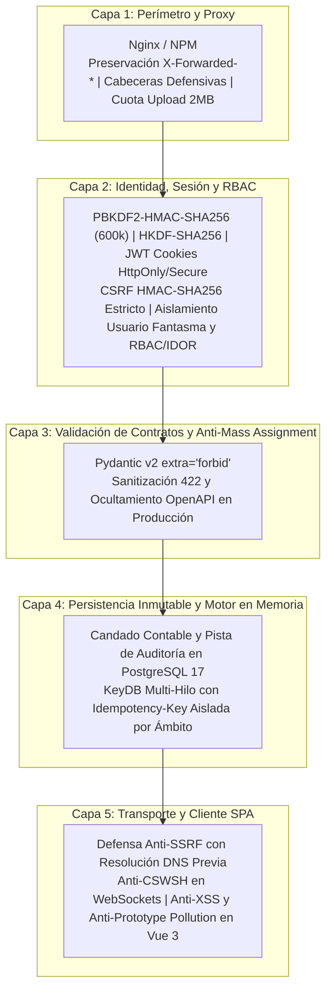

# 🛡️ Política de Seguridad y Arquitectura de Defensa — Condominio App

**Proyecto:** Condominio App — Estándar Corporativo Nivel 11X  
**Licencia:** MIT  
**Estándar de Certificación:** QA 11X DevSecOps (`qa-testing-blueprints`)

En **Condominio App**, la seguridad de los fondos comunitarios, la privacidad de los propietarios e inquilinos y la integridad contable son la máxima prioridad. Este documento establece los estándares de **Seguridad por Diseño (Security-by-Design)**, la mitigación de los **22 vectores de ataque** en arquitecturas híbridas (SPA Vue 3 + API Asíncrona FastAPI + Infraestructura Productiva) y la política de auditoría preventiva **Shift-Left**.

---

## 1. Versiones Soportadas

| Versión | Estado de Soporte | Requisitos de Infraestructura |
| :--- | :--- | :--- |
| **`1.0.x` (`v1.0.0` / `main`)** | ✅ Soporte Activo | Docker 26+, PostgreSQL 17, KeyDB Multi-Hilo, MinIO |
| **`< 1.0`** | ❌ No Soportado | Versiones preliminares descontinuadas |

---

## 2. Reporte Responsable de Vulnerabilidades

Si descubres una vulnerabilidad en la API, en la interfaz web o en los manifiestos de infraestructura:

1. **NO abras un Issue ni Pull Request público en GitHub/GitLab** con el exploit o vector de ataque.
2. Envía un reporte detallado por correo a: **`soporte@tecnoconsultores.net`** con el asunto `[SECURITY-CONDOMINIO] Descripción breve del hallazgo`.
3. Incluye los pasos de reproducción, componentes afectados y el impacto potencial.
4. Recibirás acuse de recibo en un máximo de **48 horas laborables** y coordinaremos la mitigación antes de la divulgación pública.

---

## 3. Pilares de Seguridad por Diseño (Defensa en Profundidad)

---

## 4. Mitigación Integral de los 22 Vectores de Ataque Híbridos (SPA + API)

### 4.1. Prevención de Asignación Masiva (*Mass Assignment / Over-posting*)
- **Riesgo:** Un atacante inyecta atributos no autorizados en el JSON de registro o pago (ej. `"rol": "TESORERO"`, `"es_activo": true`, `"estado": "APROBADO"`).
- **Mitigación Implementada:** Todos los esquemas Pydantic de entrada en `backend/src/schemas.py` y `backend/src/routers/auth.py` declaran `model_config = ConfigDict(extra="forbid")`, rechazando cualquier campo inesperado con HTTP 422.

### 4.2. Protección Anti-CSWSH (*Cross-Site WebSocket Hijacking*)
- **Riesgo:** Secuestro de canales en tiempo real desde orígenes cruzados maliciosos cuando el usuario posee una cookie activa.
- **Mitigación Implementada:** La función `verify_websocket_origin` en `backend/src/security.py` inspecciona la cabecera `Origin` contra la lista blanca `ALLOWED_ORIGINS` antes de aceptar conexiones WebSocket (código de cierre `4403`).

### 4.3. Sanitización de Errores de Validación 422 (`RequestValidationError`)
- **Riesgo:** Exposición en producción de expresiones regulares internas y estructura de esquemas en errores 422.
- **Mitigación Implementada:** En `backend/src/main.py`, cuando `APP_ENV == "production"`, el manejador de `RequestValidationError` registra el detalle en los logs internos y devuelve al cliente un mensaje opaco seguro: `{"detail": "Los datos proporcionados no cumplen con los requisitos de validación."}`.

### 4.4. Defensa Anti-SSRF Estricta (`validate_safe_outgoing_url`)
- **Riesgo:** Manipulación de URLs de comprobantes (`url_comprobante`), facturas (`url_factura`) o webhooks para escanear la red interna de contenedores o metadatos cloud (`169.254.169.254`).
- **Mitigación Implementada:** `validate_safe_outgoing_url` en `backend/src/security.py` valida el esquema (`http`/`https`), bloquea nombres de host internos (`localhost`, `api`, `postgres`, `keydb`, `redis`, `worker`, `minio`), resuelve DNS previamente y bloquea rangos privados RFC 1918, loopback, link-local y reservados.

### 4.5. Consultas Parametrizadas Seguras en Base de Datos
- **Riesgo:** Inyección SQL por interpolación de cadenas.
- **Mitigación Implementada:** Uso exclusivo del ORM tipado de SQLAlchemy 2.0 y sentencias parametrizadas (`bindparams`).

### 4.6. Límites Estrictos de Carga de Archivos (Anti-DoS / OOM)
- **Riesgo:** Agotamiento de memoria RAM al subir comprobantes o fotografías de gran tamaño.
- **Mitigación Implementada:** `read_uploaded_file_safely` en `backend/src/security.py` lee en bloques de 64 KB e impone una cuota máxima de **2 MB** (`MAX_UPLOAD_SIZE_BYTES`), abortando al instante con HTTP `413 Request Entity Too Large`.

### 4.7. Preservación de Cabeceras de Proxy Inverso, CSP, Fetch Metadata y Cabeceras HTTP Defensivas
- **Mitigación Implementada:** Middleware HTTP `security_headers_middleware` en `backend/src/main.py` que:
  - Inyecta en toda respuesta `Cache-Control: no-store`, `X-Content-Type-Options: nosniff`, `X-Frame-Options: DENY`, `Referrer-Policy: strict-origin-when-cross-origin`, `Content-Security-Policy` (`default-src 'none'; frame-ancestors 'none'; base-uri 'none'; form-action 'self'; object-src 'none'` en rutas API; política restringida con CDN Swagger/ReDoc en `/docs` y `/redoc`), `Cross-Origin-Opener-Policy: same-origin-allow-popups`, `Cross-Origin-Resource-Policy: same-origin`, `Permissions-Policy: camera=(), microphone=(), geolocation=(), payment=(), usb=()` y fusión sin duplicados de `Vary: Sec-Fetch-Dest, Sec-Fetch-Mode, Sec-Fetch-Site`.
  - Emite `Strict-Transport-Security: max-age=31536000; includeSubDomains` de forma condicional cuando `COOKIE_SECURE=true`, `APP_ENV=production` o señal TLS/proxy `HTTPS`.
  - Ejecuta aislamiento temprano **Fetch Metadata** (`_is_allowed_fetch_metadata`) antes de la autenticación y el enrutamiento: permite `same-origin`, `same-site`, `none`, clientes sin `Sec-Fetch-Site` y navegaciones seguras `GET`/`HEAD` (`navigate` distinto de `object`/`embed`), rechazando solicitudes `cross-site` no navegables (ej. `cors`, `no-cors`, `POST`) con `HTTP 403`.

### 4.8. Tokens Anti-CSRF HMAC-SHA256 y Exclusión de Tokens Bearer (M2M/MCP)
- **Mitigación Implementada:** `generate_csrf_token` y `validate_csrf_token` en `backend/src/security.py` emplean firmas `HMAC-SHA256` y comparación en tiempo constante (`hmac.compare_digest`). Además, `get_current_user` en `backend/src/dependencies.py` soporta tanto cookies `HttpOnly` como cabeceras `Authorization: Bearer` para herramientas automatizadas y servidores MCP.

### 4.9. Prevención de XSS y Prototype Pollution en Frontend Vue 3
- **Mitigación Implementada (`docs/specs/05_ARQUITECTURA_GUI_VUE3_MOBILE_FIRST.md`):** Uso obligatorio de `escapeHtml` y `sanitizeObject` (`Object.create(null)`, filtrado de `__proto__`, `constructor`, `prototype`) en `frontend/src/utils/security.ts`.

### 4.10. Tolerancia a Carreras Concurrentes (*Grace Period* de 5s) en Refresh Tokens
- **Mitigación Implementada:** `rotate_refresh_token_with_grace_period` y `check_refresh_token_grace_period` en `backend/src/redis_client.py` almacenan una ventana de cortesía de 5 segundos en KeyDB para evitar cierres de sesión falsos cuando un propietario abre varias pestañas simultáneamente.

### 4.11. Aislamiento por Usuario y Ámbito en Llaves de Idempotencia
- **Riesgo:** Colisión cruzada de UUIDs de idempotencia entre distintos usuarios o flujos.
- **Mitigación Implementada:** `build_idempotency_key(scope, key)` en `backend/src/redis_client.py` aísla las claves bajo `idemp:{scope}:{key}` (ej. `idemp:user:7:<uuid>` en reporte de pagos y `idemp:register:<uuid>` en registro).

### 4.12. Ocultación de Swagger / ReDoc / OpenAPI en Producción
- **Mitigación Implementada:** En `backend/src/main.py`, cuando `APP_ENV == "production"`, `docs_url`, `redoc_url` y `openapi_url` se desactivan (`None`).

### 4.13. Gobernanza Shift-Left de Lockfiles (`uv.lock` y `pnpm-lock.yaml`)
- **Mitigación Implementada:** Auditoría continua mediante `make -C backend qa-deps` (`uv audit`), `make -C frontend qa-lint` (`pnpm audit --audit-level=high` y `pnpm audit --prod --audit-level=high` con `0` vulnerabilidades en producción; exclusión temporal documentada en `frontend/pnpm-workspace.yaml` para `GHSA-fc5q-39xc-vjpf` en `picomatch <=4.0.7` exclusivamente de herramientas dev), configuración `.npmrc` (`ignore-scripts=true`) y `./scripts/auditar-infra.sh` (Trivy IaC + FS `HIGH/CRITICAL = 0`).

### 4.14. Saneamiento de Esquemas en URLs de Evidencia (`UrlEvidenciaSegura`)
- **Mitigación Implementada:** Validación estricta en `backend/src/schemas.py` que bloquea esquemas `javascript:`, `data:`, `vbscript:` y `file:` en comprobantes, facturas y fotos.

### 4.15. Inspección de *Magic Bytes* Binarios en Subida de Archivos
- **Mitigación Implementada (`docs/specs/01_ARQUITECTURA_Y_SEGURIDAD_11X.md`):** Verificación de la firma binaria real (`%PDF-`, `\x89PNG`, `\xFF\xD8\xFF`, `RIFF....WEBP`, `ftypavif`) dentro de `read_uploaded_file_safely` antes de procesar o almacenar archivos.

### 4.16. Revocación Instantánea de Sesiones en KeyDB Multi-Hilo
- **Mitigación Implementada (`docs/specs/02_DOMINIO_IDENTIDAD_ESTRUCTURA_Y_RBAC.md`):** Al desactivar un usuario o finalizar su contrato de ocupación, se registra `revoked_user:{id}` en KeyDB para invalidar en el acto cualquier JWT vigente.

### 4.17. No Repudio y Anti-Replay en Pases QR, Cartas Consulta y Certificados de Solvencia
- **Mitigación Implementada (`docs/specs/07..09`):** Sello criptográfico `HMAC-SHA256` verificado con `hmac.compare_digest` para Certificados de Solvencia, Votos en Cartas Consulta y Pases de Visita QR, combinado con quema atómica de `jti` (`SET qr_used:{jti} 1 NX EX {ttl}`) en KeyDB Multi-Hilo.

### 4.18. Bloqueo Anti-Fraude de Referencias Bancarias Duplicadas
- **Mitigación Implementada (`docs/specs/07_DOMINIO_ALICUOTAS_FACTURACION_Y_SOLVENCIA.md`):** Restricción de unicidad sobre `(metodo, numero_referencia)` para impedir que múltiples reportes de pago reutilicen el mismo número de operación bancaria.

### 4.19. Arranque Fail-Fast, KDF Estricto PBKDF2 (`600_000`) y Subclaves `HKDF-SHA256` (Hitos 17.1 y 20)
- **Mitigación Implementada:**
  - **Validación Fail-Fast (`backend/src/security.py`, `backend/src/main.py`):** `validate_production_security_settings()` aborta inmediatamente con `RuntimeError` si `APP_ENV=production` intenta iniciar con `SECRET_KEY` insegura/placeholder (< 32 caracteres) o `DATABASE_URL` vacía / SQLite `:memory:`.
  - **PBKDF2 Asíncrono (`600_000` iteraciones) y Anti-Timing:** `hash`/`verify_password` ejecutan `PBKDF2-HMAC-SHA256` (`600_000` iteraciones) vía `asyncio.to_thread` con contraseñas acotadas (`8..128` caracteres) y rechazan hashes legacy sin sal mediante cómputo constante para evitar enumeración temporal.
  - **Subclaves Independientes `HKDF-SHA256` y JWT Estrictos:** Derivación RFC 5869 separada para acceso, refresco, CSRF, solvencia, voto, QR y auditoría WORM con `hmac.compare_digest` y verificación obligatoria de claims `typ`, `iat`, `iss`, `aud` y `condominio_id`.
  - **Bootstrap Seguro (`backend/src/bootstrap.py`):** Lectura desde entorno (`BOOTSTRAP_ADMIN_PASSWORD`) sin argumento `--password` en CLI y bloqueo explícito de reactivación de cuentas deshabilitadas administrativamente.

### 4.20. Ciclo de Sesión, CSRF Real, Lockout Lua, KeyDB Fail-Closed 7d y Perímetro HTTP/SSRF (Hitos 17.2 y 20)
- **Mitigación Implementada:**
  - **Revocación por Dispositivo y Purga (`POST /api/auth/logout`):** Invoca `revoke_session_id` y `mark_refresh_jti_used` en KeyDB, elimina las cookies `access_token`, `refresh_token` y `csrf_token`, y envía `Clear-Site-Data: "cookies", "storage", "cache"`; mantiene `REVOKED_USER_TTL_SECONDS >= 7 días` sin fugas RAM ni limpieza indebida de bloqueos administrativos en `/login`.
  - **Rotación Anti-Replay de Refresh Tokens (`POST /api/auth/refresh`):** Ventana concurrente de cortesía de `5s` (`rotate_refresh_token_with_grace_period`); cualquier reuso posterior revoca el `sid` completo (`HTTP 401`).
  - **CSRF Real y Perímetro HTTP (`backend/src/main.py`):** Exige `X-CSRF-Token` siempre que exista cookie de sesión `HttpOnly` (cerrando el bypass con `Authorization: Bearer` simultáneo), protege `/metrics` con `METRICS_AUTH_TOKEN`, valida `ALLOWED_HOSTS` (`400`) y `TRUSTED_PROXY_IPS` en `X-Forwarded-Proto`, y garantiza cabeceras OSHP incluso ante errores `500`.
  - **Lockout Atómico Lua (`POST /api/auth/login`), KeyDB Fail-Closed e Anti-SSRF Asíncrono:** Script Lua `_LUA_INCR_EXPIRE` (`5` fallos por IP y `10` globales por cuenta en `15m` -> `HTTP 429`) + `DUMMY_PASSWORD_HASH`; `HTTP 503` *fail-closed* si KeyDB cae en producción; `Idempotency-Key` (`8..128` chars, TTL `86400s`, *replay* `2xx` y liberación en `4xx`/`5xx`); bloqueo de `//` y caracteres de control en `UrlEvidenciaSegura` y validación DNS asíncrona normalizada en minúsculas.

### 4.21. Aislamiento PG17 RLS (`condominio_app_runtime`), WORM Hash-Chain, `PRAGMA foreign_keys=ON` y Cierre RBAC/IDOR (Hitos 17.4 y 20)
- **Mitigación Implementada:**
  - **PG17 Runtime No-Superusuario, `FORCE RLS`, `PRAGMA foreign_keys=ON` y Migración `0010`:** Separación entre rol migrador (`condominio_admin` / `ADMIN_DATABASE_URL` en `backend/alembic/env.py`) y usuario runtime (`condominio_app` / `DATABASE_URL`) sujeto a `SET LOCAL ROLE condominio_app_runtime` (`NOBYPASSRLS`), política `tenant_isolation_policy` (`ENABLE` + `FORCE ROW LEVEL SECURITY`) en las `27` tablas ORM, valor por defecto *fail-closed* (`app.current_tenant_id = ''`) e inyección transaccional `bind_rls_tenant()` en `database.py`, `dependencies.py`, `facturacion_lph.py` y `worker.py`, junto con `PRAGMA foreign_keys=ON` en SQLite y validación HTTP/concurrencia real sobre PostgreSQL 17 (`make -C backend qa-parity`).
  - **Claves Compuestas Multi-Tenant y Sellado WORM:** Migración `0010_rls_multitenant_worm_checks.py` convierte restricciones `UNIQUE` globales a claves compuestas con `condominio_id`, indexa claves foráneas, añade `CheckConstraint` contables y aplica cadena hash WORM (`prev_hash`/`record_hash` + `REVOKE UPDATE, DELETE` en PG17 y triggers SQLite) sobre `auditoria_recibos` y `votos_consulta`.
  - **Anti-Replay `jti`, Privacidad DTO y Cierre RBAC/IDOR:** UUIDv4 `jti` firmado con `HKDF-SHA256` + verificación viva `deuda_viva == 0` en `/api/finanzas/solvencia/verificar/{folio}`; `verificar_usuario_activo` *fail-closed*; bloqueo de escalación `VICEPRESIDENTE -> PRESIDENTE` en `/api/usuarios/{id}/asignar`; vigencia `ContratoOcupacion.fecha_fin.is_(None)` en `_verificar_acceso_unidad`; y contención horizontal/DTO en `estructura/unidades`, `finanzas/resumen`, `paqueteria`, `reservas` y `accesos/pases/mios`.

### 4.22. Endurecimiento de Contenedores No-Root, Worker Supervisado, Respaldos Cifrados, FINOS CALM `1.2` y Contención Operativa (Hitos 18 y 19)
- **Mitigación Implementada:**
  - **Imágenes Productivas Multi-Stage No-Root (`CONTAINER_ROLE=api|worker`) y Nginx OSHP:** Runtime backend `python:3.13-slim-bookworm` (`uv sync --frozen --no-dev`, sin `pip`/`ensurepip`, `10001:10001`) y frontend `nginx:1.27-alpine` (`101:101`, puerto `8080`, `gzip on`, `/tmp/nginx_*_temp`, `server_tokens off`, `client_max_body_size 2M` y repetición íntegra de las `9` cabeceras OSHP/CSP dentro de `location /assets/`), certificados con **`Trivy HIGH/CRITICAL = 0`** y validados en `docker-compose.yml` / `docker-compose.prod.yml` (`read_only: true`, `cap_drop: [ALL]`, `no-new-privileges:true`, `backend_net` interna y puerto único `127.0.0.1:${FRONTEND_PORT:-8080}:8080`).
  - **Worker Asíncrono Endurecido (`worker.py`, `worker_media.py`, `worker_scheduler.py`):** Sanitización anti-CRLF en cabeceras SMTP (`STARTTLS`), `BLMOVE` confiable con DLQ acotado (`queue:notifications:dlq`), `Image.MAX_IMAGE_PIXELS`, carga MinIO `AWS4-HMAC-SHA256` RFC 3986 con soporte `MINIO_USE_SSL` y supervisión `QA-HEALTH-01` por heartbeat físico.
  - **Respaldos Transaccionales y Contención Operativa (`scripts/backup-diario.sh`, `limpieza.sh`, `verificar-secretos.sh`):** Sin `|| true` en `mc mirror`, verificación `> 0 bytes`, `trap cleanup_staging EXIT`, sumas `.sha256`, cifrado `AES-256-CBC + PBKDF2` (`100000` iteraciones) y alerta `APSC-DV-001090` (`>= 75%` disco); contención exclusiva de `limpieza.sh` sobre `docker-compose*.qa.yml` protegiendo `postgres_data`/`minio_data` y `artifacts/sbom/`; y escáner `verificar-secretos.sh` con `grep -e` sobre el árbol completo desde `REPO_ROOT`.
  - **Validación FINOS CALM `1.2` y Workflows SHA-40:** Modelo `architecture/qa-11x.calm.json` validado con `7` controles de seguridad obligatorios y todas las GitHub Actions fijadas por digest SHA-40 (`SEC-CI-ACTION-REF`).

---

## 5. Barreras Automatizadas DevSecOps

Antes de cada commit local y publicación (`QA-GIT-GATE-01`), el código supera en contenedores Docker efímeros (`Rule Zero`):
1. **Detección de Secretos:** `./scripts/verificar-secretos.sh` (`grep -e` sobre el árbol completo, `.env.example` y suites incluidos; `0` credenciales expuestas).
2. **SAST Estático, Complejidad Radon Grado A y FINOS CALM:** `Ruff`, `Mypy --strict`, `Bandit`, **`Radon` Grado A estricto (`CC <= 5`, `MI >= A` en `backend/scripts/radon_gates.py`)**, ESLint/SonarJS (`CC <= 15`), `validate_calm_architecture.sh` (`7` controles FINOS CALM `1.2`), Graphify AST `--code-only` y `audit_security_stig_owasp` (`0` hallazgos).
3. **Cobertura `>= 95%`, Paridad Real SQLite/PG17, Mutación y DAST No-Root:** Cobertura **`>= 95%`** en Backend (`pytest`), Frontend (`Vitest`) y Bash (`kcov >= 95%` en `make qa-bash`); integridad **`PRAGMA foreign_keys=ON`** en SQLite más pruebas HTTP y de concurrencia sobre **PostgreSQL 17** real (`make -C backend qa-parity`); mutación `>= 80%` MSI (`mutmut`, `Stryker`); **DAST OWASP ZAP en contenedor no-root** (`make -C backend qa-dast` con `backend/zap.yaml`, sin `user: root`, `FAIL-NEW: 0` / `WARN-NEW: 0`); Karate Labs API/UI BDD, Schemathesis, Playwright + `@axe-core` WCAG 2.1 AA, Lighthouse CI y Pumba + Locust.
4. **Auditoría IaC, Dependencias y Compuerta 11X:** `./scripts/auditar-infra.sh` (`Trivy IaC + FS HIGH/CRITICAL = 0`), `uv audit` / `pnpm audit --prod --audit-level=high` (`0` CVEs en producción), SBOM CycloneDX en `artifacts/sbom/`, `certify_11x_gate` (`@sinfallas/mcp-qa-11x`) y `./.agents/scripts/certify_task_completion.sh --strict` (`10/10 PASS`).
