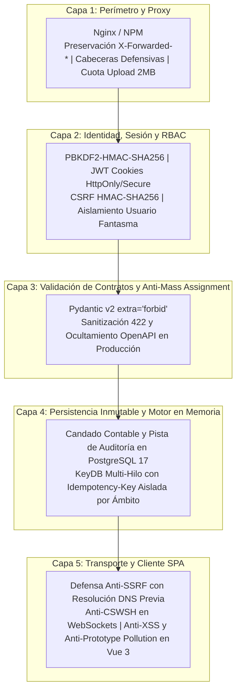

# 🛡️ Política de Seguridad y Arquitectura de Defensa — Condominio App

**Proyecto:** Condominio App — Estándar Corporativo Nivel 11X  
**Licencia:** MIT  
**Estándar de Certificación:** QA 11X DevSecOps (`qa-testing-blueprints`)

En **Condominio App**, la seguridad de los fondos comunitarios, la privacidad de los propietarios e inquilinos y la integridad contable son la máxima prioridad. Este documento establece los estándares de **Seguridad por Diseño (Security-by-Design)**, la mitigación de los 20 vectores de ataque en arquitecturas híbridas (SPA Vue 3 + API Asíncrona FastAPI + Infraestructura Productiva) y la política de auditoría preventiva **Shift-Left**.

---

## 1. Versiones Soportadas

| Versión | Estado de Soporte | Requisitos de Infraestructura |
| :--- | :--- | :--- |
| **`1.0.x` (`v1.0.0` / `main`)** | ✅ Soporte Activo | Docker 26+, PostgreSQL 17, KeyDB Multi-Hilo, MinIO |
| **`< 1.0`** | ❌ No Soportado | Versiones preliminares descontinuadas |

---

## 2. Reporte Responsable de Vulnerabilidades

Si descubres una vulnerabilidad en la API, en la interfaz web o en los manifiestos de infraestructura:

1. **NO abras un Issue ni Pull Request público en GitHub/GitLab** con el exploit o vector de ataque.
2. Envía un reporte detallado por correo a: **`soporte@tecnoconsultores.net`** con el asunto `[SECURITY-CONDOMINIO] Descripción breve del hallazgo`.
3. Incluye los pasos de reproducción, componentes afectados y el impacto potencial.
4. Recibirás acuse de recibo en un máximo de **48 horas laborables** y coordinaremos la mitigación antes de la divulgación pública.

---

## 3. Pilares de Seguridad por Diseño (Defensa en Profundidad)

---

## 4. Mitigación Integral de los 20 Vectores de Ataque Híbridos (SPA + API)

### 4.1. Prevención de Asignación Masiva (*Mass Assignment / Over-posting*)
- **Riesgo:** Un atacante inyecta atributos no autorizados en el JSON de registro o pago (ej. `"rol": "TESORERO"`, `"es_activo": true`, `"estado": "APROBADO"`).
- **Mitigación Implementada:** Todos los esquemas Pydantic de entrada en `backend/src/schemas.py` y `backend/src/routers/auth.py` declaran `model_config = ConfigDict(extra="forbid")`, rechazando cualquier campo inesperado con HTTP 422.

### 4.2. Protección Anti-CSWSH (*Cross-Site WebSocket Hijacking*)
- **Riesgo:** Secuestro de canales en tiempo real desde orígenes cruzados maliciosos cuando el usuario posee una cookie activa.
- **Mitigación Implementada:** La función `verify_websocket_origin` en `backend/src/security.py` inspecciona la cabecera `Origin` contra la lista blanca `ALLOWED_ORIGINS` antes de aceptar conexiones WebSocket (código de cierre `4403`).

### 4.3. Sanitización de Errores de Validación 422 (`RequestValidationError`)
- **Riesgo:** Exposición en producción de expresiones regulares internas y estructura de esquemas en errores 422.
- **Mitigación Implementada:** En `backend/src/main.py`, cuando `APP_ENV == "production"`, el manejador de `RequestValidationError` registra el detalle en los logs internos y devuelve al cliente un mensaje opaco seguro: `{"detail": "Los datos proporcionados no cumplen con los requisitos de validación."}`.

### 4.4. Defensa Anti-SSRF Estricta (`validate_safe_outgoing_url`)
- **Riesgo:** Manipulación de URLs de comprobantes (`url_comprobante`), facturas (`url_factura`) o webhooks para escanear la red interna de contenedores o metadatos cloud (`169.254.169.254`).
- **Mitigación Implementada:** `validate_safe_outgoing_url` en `backend/src/security.py` valida el esquema (`http`/`https`), bloquea nombres de host internos (`localhost`, `api`, `postgres`, `keydb`, `redis`, `worker`, `minio`), resuelve DNS previamente y bloquea rangos privados RFC 1918, loopback, link-local y reservados.

### 4.5. Consultas Parametrizadas Seguras en Base de Datos
- **Riesgo:** Inyección SQL por interpolación de cadenas.
- **Mitigación Implementada:** Uso exclusivo del ORM tipado de SQLAlchemy 2.0 y sentencias parametrizadas (`bindparams`).

### 4.6. Límites Estrictos de Carga de Archivos (Anti-DoS / OOM)
- **Riesgo:** Agotamiento de memoria RAM al subir comprobantes o fotografías de gran tamaño.
- **Mitigación Implementada:** `read_uploaded_file_safely` en `backend/src/security.py` lee en bloques de 64 KB e impone una cuota máxima de **2 MB** (`MAX_UPLOAD_SIZE_BYTES`), abortando al instante con HTTP `413 Request Entity Too Large`.

### 4.7. Preservación de Cabeceras de Proxy Inverso, CSP, Fetch Metadata y Cabeceras HTTP Defensivas
- **Mitigación Implementada:** Middleware HTTP `security_headers_middleware` en `backend/src/main.py` que:
  - Inyecta en toda respuesta `Cache-Control: no-store`, `X-Content-Type-Options: nosniff`, `X-Frame-Options: DENY`, `Referrer-Policy: strict-origin-when-cross-origin`, `Content-Security-Policy` (`default-src 'none'; frame-ancestors 'none'; base-uri 'none'; form-action 'self'; object-src 'none'` en rutas API; política restringida con CDN Swagger/ReDoc en `/docs` y `/redoc`), `Cross-Origin-Opener-Policy: same-origin-allow-popups`, `Cross-Origin-Resource-Policy: same-origin`, `Permissions-Policy: camera=(), microphone=(), geolocation=(), payment=(), usb=()` y fusión sin duplicados de `Vary: Sec-Fetch-Dest, Sec-Fetch-Mode, Sec-Fetch-Site`.
  - Emite `Strict-Transport-Security: max-age=31536000; includeSubDomains` de forma condicional cuando `COOKIE_SECURE=true`, `APP_ENV=production` o señal TLS/proxy `HTTPS`.
  - Ejecuta aislamiento temprano **Fetch Metadata** (`_is_allowed_fetch_metadata`) antes de la autenticación y el enrutamiento: permite `same-origin`, `same-site`, `none`, clientes sin `Sec-Fetch-Site` y navegaciones seguras `GET`/`HEAD` (`navigate` distinto de `object`/`embed`), rechazando solicitudes `cross-site` no navegables (ej. `cors`, `no-cors`, `POST`) con `HTTP 403`.

### 4.8. Tokens Anti-CSRF HMAC-SHA256 y Exclusión de Tokens Bearer (M2M/MCP)
- **Mitigación Implementada:** `generate_csrf_token` y `validate_csrf_token` en `backend/src/security.py` emplean firmas `HMAC-SHA256` y comparación en tiempo constante (`hmac.compare_digest`). Además, `get_current_user` en `backend/src/dependencies.py` soporta tanto cookies `HttpOnly` como cabeceras `Authorization: Bearer` para herramientas automatizadas y servidores MCP.

### 4.9. Prevención de XSS y Prototype Pollution en Frontend Vue 3
- **Mitigación Implementada (`docs/specs/05_ARQUITECTURA_GUI_VUE3_MOBILE_FIRST.md`):** Uso obligatorio de `escapeHtml` y `sanitizeObject` (`Object.create(null)`, filtrado de `__proto__`, `constructor`, `prototype`) en `frontend/src/utils/security.ts`.

### 4.10. Tolerancia a Carreras Concurrentes (*Grace Period* de 5s) en Refresh Tokens
- **Mitigación Implementada:** `rotate_refresh_token_with_grace_period` y `check_refresh_token_grace_period` en `backend/src/redis_client.py` almacenan una ventana de cortesía de 5 segundos en KeyDB para evitar cierres de sesión falsos cuando un propietario abre varias pestañas simultáneamente.

### 4.11. Aislamiento por Usuario y Ámbito en Llaves de Idempotencia
- **Riesgo:** Colisión cruzada de UUIDs de idempotencia entre distintos usuarios o flujos.
- **Mitigación Implementada:** `build_idempotency_key(scope, key)` en `backend/src/redis_client.py` aísla las claves bajo `idemp:{scope}:{key}` (ej. `idemp:user:7:<uuid>` en reporte de pagos y `idemp:register:<uuid>` en registro).

### 4.12. Ocultación de Swagger / ReDoc / OpenAPI en Producción
- **Mitigación Implementada:** En `backend/src/main.py`, cuando `APP_ENV == "production"`, `docs_url`, `redoc_url` y `openapi_url` se desactivan (`None`).

### 4.13. Gobernanza Shift-Left de Lockfiles (`uv.lock` y `pnpm-lock.yaml`)
- **Mitigación Implementada:** Auditoría continua mediante `make -C backend qa-deps` (`uv audit`), `make -C frontend qa-lint` (`pnpm audit --audit-level=high`), configuración `.npmrc` (`ignore-scripts=true`) y `./scripts/auditar-infra.sh` (Trivy IaC + FS `HIGH/CRITICAL` = 0).

### 4.14. Saneamiento de Esquemas en URLs de Evidencia (`UrlEvidenciaSegura`)
- **Mitigación Implementada:** Validación estricta en `backend/src/schemas.py` que bloquea esquemas `javascript:`, `data:`, `vbscript:` y `file:` en comprobantes, facturas y fotos.

### 4.15. Inspección de *Magic Bytes* Binarios en Subida de Archivos
- **Mitigación Implementada (`docs/specs/01_ARQUITECTURA_Y_SEGURIDAD_11X.md`):** Verificación de la firma binaria real (`%PDF-`, `\x89PNG`, `\xFF\xD8\xFF`, `RIFF....WEBP`, `ftypavif`) dentro de `read_uploaded_file_safely` antes de procesar o almacenar archivos.

### 4.16. Revocación Instantánea de Sesiones en KeyDB Multi-Hilo
- **Mitigación Implementada (`docs/specs/02_DOMINIO_IDENTIDAD_ESTRUCTURA_Y_RBAC.md`):** Al desactivar un usuario o finalizar su contrato de ocupación, se registra `revoked_user:{id}` en KeyDB para invalidar en el acto cualquier JWT vigente.

### 4.17. No Repudio y Anti-Replay en Pases QR, Cartas Consulta y Certificados de Solvencia
- **Mitigación Implementada (`docs/specs/07..09`):** Sello criptográfico `HMAC-SHA256` verificado con `hmac.compare_digest` para Certificados de Solvencia, Votos en Cartas Consulta y Pases de Visita QR, combinado con quema atómica de `jti` (`SET qr_used:{jti} 1 NX EX {ttl}`) en KeyDB Multi-Hilo.

### 4.18. Bloqueo Anti-Fraude de Referencias Bancarias Duplicadas
- **Mitigación Implementada (`docs/specs/07_DOMINIO_ALICUOTAS_FACTURACION_Y_SOLVENCIA.md`):** Restricción de unicidad sobre `(metodo, numero_referencia)` para impedir que múltiples reportes de pago reutilicen el mismo número de operación bancaria.

### 4.19. Arranque Fail-Fast y KDF Estricto PBKDF2 en Producción (Hito 17.1)
- **Mitigación Implementada:** En `backend/src/security.py` y `lifespan` de `backend/src/main.py`, `validate_production_security_settings()` aborta inmediatamente con `RuntimeError` si `APP_ENV=production` intenta iniciar con la `SECRET_KEY` por defecto (< 32 caracteres o valor de desarrollo) o `DATABASE_URL` vacía / SQLite `:memory:`. Asimismo, `verify_password` rechaza hashes heredados SHA-256 sin sal aplicando un cómputo ficticio `PBKDF2-HMAC-SHA256` en tiempo constante para evitar enumeración temporal.

### 4.20. Ciclo Completo de Sesión, CSRF Real, Lockout Anti-Brute-Force y KeyDB Fail-Closed (Hito 17.2)
- **Mitigación Implementada:**
  - **Revocación y Purga Completa (`POST /api/auth/logout`):** Invoca `revoke_session_id` y `mark_refresh_jti_used` en KeyDB, elimina las cookies `access_token`, `refresh_token` y `csrf_token`, y envía `Clear-Site-Data: "cookies", "storage", "cache"`.
  - **Rotación Anti-Replay de Refresh Tokens (`POST /api/auth/refresh`):** Mantiene ventana concurrente de cortesía de `5s` (`rotate_refresh_token_with_grace_period`); cualquier reuso posterior revoca el `sid` completo (`HTTP 401`).
  - **Middleware CSRF Real (`backend/src/main.py`):** Exige `X-CSRF-Token` validado por `HMAC-SHA256` en mutaciones por cookie cuando `APP_ENV=production` o `CSRF_ENFORCE=true` (eximiendo `Authorization: Bearer` para clientes M2M/MCP), con cookie `secure` configurable mediante `COOKIE_SECURE`.
  - **Lockout Anti-Fuerza Bruta (`POST /api/auth/login`):** Bloquea por `(ip, correo)` tras `5` fallos en `15 minutos` (`HTTP 429`) y ejecuta cómputo constante `DUMMY_PASSWORD_HASH` para correos inexistentes.
  - **KeyDB Fail-Closed e Idempotencia Canónica (`backend/src/redis_client.py`):** Falla cerrado con `HTTP 503` si KeyDB cae en `APP_ENV=production`, eleva el TTL de idempotencia a `86400s` (24h) y exige cabeceras `Idempotency-Key` de `8..128` caracteres.

### 4.21. Aislamiento Multi-Tenant PG17 RLS, Anti-Replay `jti` y Privacidad DTO Pública (Hito 17.4)
- **Mitigación Implementada:**
  - **Row-Level Security Forzado en PostgreSQL 17 (`backend/alembic/versions/0008_hito17_integridad_y_rls.py`, `backend/src/database.py`):** Columna `condominio_id`, política `tenant_isolation_policy` (`ENABLE` + `FORCE ROW LEVEL SECURITY`) en las 27 tablas del esquema ORM, rol runtime no privilegiado `condominio_app_runtime` (`NOBYPASSRLS`) e inyección transaccional `set_config('app.current_tenant_id', ...)` / `app.is_superadmin` en cada inicio de transacción SQLAlchemy (`after_begin`), con comportamiento *fail-closed* si no existe tenant asignado.
  - **Anti-Replay `jti` y Vigencia Viva en Solvencia/Votos (`backend/src/finanzas.py`, `routers/consultas.py`, `routers/finanzas.py`):** Identificador único UUIDv4 (`jti`) en `VotoConsulta` y `CertificadoSolvencia` vinculado a firma `HMAC-SHA256` (`v2`) y verificación dinámica de deuda viva (`deuda_viva == 0`) al consultar `/api/finanzas/solvencia/verificar/{folio}`.
  - **Privacidad de Catálogo Público (`backend/src/dependencies.py`, `routers/administracion.py`):** `GET /api/estructura/unidades` entrega exclusivamente `UnidadPublicaResponse` (`id`, `identificador`, `estructura_id`) cuando no existe usuario activo autenticado, ocultando `alicuota`, `cuota_fija_usd` y `credito_disponible_usd`.

### 4.22. Endurecimiento de Contenedores No-Root, Worker Supervisado y Respaldos Cifrados (Hito 18)
- **Mitigación Implementada:**
  - **Imágenes Productivas Multi-Stage No-Root (`backend/Dockerfile`, `frontend/Dockerfile`):** Runtime backend (`python:3.13-slim-bookworm`) sin herramientas de desarrollo (`uv sync --frozen --no-dev`) ni `pip`/`ensurepip` ejecutándose como `10001:10001` (`appuser`), y frontend `nginx:1.27-alpine` endurecido como `101:101` en el puerto `8080`, ambos certificados con **`Trivy HIGH/CRITICAL = 0`**.
  - **Aislamiento Runtime y Red (`docker-compose.yml`, `frontend/nginx.conf`):** Bandera `read_only: true` + `tmpfs /tmp`, `cap_drop: [ALL]`, `no-new-privileges:true`, red interna aislada `backend_net` (`internal: true`), exposición únicamente de `127.0.0.1:${FRONTEND_PORT:-8080}:8080`, `server_tokens off`, `client_max_body_size 2M` y cabeceras OWASP OSHP (`CSP`, `X-Frame-Options: DENY`, `COOP`, `CORP`).
  - **Worker Real Endurecido (`backend/src/worker.py`) y Respaldos (`scripts/backup-diario.sh`):** Sanitización anti-inyección CRLF en cabeceras SMTP (`STARTTLS`), reintentos acotados con Dead-Letter Queue (`queue:notifications:dlq`), carga MinIO autenticada con `AWS4-HMAC-SHA256`, supervisión `QA-HEALTH-01` por heartbeat físico, integridad `.sha256`, cifrado opcional `AES-256-CBC + PBKDF2` (`100000` iteraciones) y alerta operativa `APSC-DV-001090` al superar el `75%` de uso en disco.

---

## 5. Barreras Automatizadas DevSecOps

Antes de cada commit y push, el código supera:
1. **Detección de Secretos:** `./scripts/verificar-secretos.sh` (0 credenciales expuestas).
2. **SAST Estático y Complejidad:** `Ruff`, `Mypy --strict`, `Bandit` y `Radon` (Grado A/B).
3. **Auditoría IaC y Dependencias:** `./scripts/auditar-infra.sh` (Trivy IaC + FS `HIGH/CRITICAL`) y `uv audit` / `pnpm audit`.
4. **Compuerta de Certificación 11X:** `certify_11x_gate` (`@sinfallas/mcp-qa-11x`) y `./.agents/scripts/certify_task_completion.sh`.
