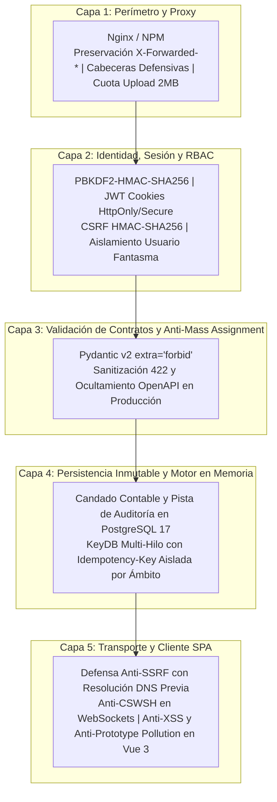

# 🛡️ Política de Seguridad y Arquitectura de Defensa — Condominio App

**Proyecto:** Condominio App — Estándar Corporativo Nivel 11X  
**Licencia:** MIT  
**Estándar de Certificación:** QA 11X DevSecOps (`qa-testing-blueprints`)

En **Condominio App**, la seguridad de los fondos comunitarios, la privacidad de los propietarios e inquilinos y la integridad contable son la máxima prioridad. Este documento establece los estándares de **Seguridad por Diseño (Security-by-Design)**, la mitigación de los 13 vectores de ataque en arquitecturas híbridas (SPA Vue 3 + API Asíncrona FastAPI) y la política de auditoría preventiva **Shift-Left**.

---

## 1. Versiones Soportadas

| Versión | Estado de Soporte | Requisitos de Infraestructura |
| :--- | :--- | :--- |
| **`main` (`1.x`)** | ✅ Soporte Activo | Docker 26+, PostgreSQL 17, KeyDB Multi-Hilo, MinIO |
| **`< 1.0`** | ❌ No Soportado | Versiones preliminares descontinuadas |

---

## 2. Reporte Responsable de Vulnerabilidades

Si descubres una vulnerabilidad en la API, en la interfaz web o en los manifiestos de infraestructura:

1. **NO abras un Issue ni Pull Request público en GitHub/GitLab** con el exploit o vector de ataque.
2. Envía un reporte detallado por correo a: **`soporte@tecnoconsultores.net`** con el asunto `[SECURITY-CONDOMINIO] Descripción breve del hallazgo`.
3. Incluye los pasos de reproducción, componentes afectados y el impacto potencial.
4. Recibirás acuse de recibo en un máximo de **48 horas laborables** y coordinaremos la mitigación antes de la divulgación pública.

---

## 3. Pilares de Seguridad por Diseño (Defensa en Profundidad)

---

## 4. Mitigación Integral de los 13 Vectores de Ataque Híbridos (SPA + API)

### 4.1. Prevención de Asignación Masiva (*Mass Assignment / Over-posting*)
- **Riesgo:** Un atacante inyecta atributos no autorizados en el JSON de registro o pago (ej. `"rol": "TESORERO"`, `"es_activo": true`, `"estado": "APROBADO"`).
- **Mitigación Implementada:** Todos los esquemas Pydantic de entrada en `backend/src/schemas.py` y `backend/src/routers/auth.py` declaran `model_config = ConfigDict(extra="forbid")`, rechazando cualquier campo inesperado con HTTP 422.

### 4.2. Protección Anti-CSWSH (*Cross-Site WebSocket Hijacking*)
- **Riesgo:** Secuestro de canales en tiempo real desde orígenes cruzados maliciosos cuando el usuario posee una cookie activa.
- **Mitigación Implementada:** La función `verify_websocket_origin` en `backend/src/security.py` inspecciona la cabecera `Origin` contra la lista blanca `ALLOWED_ORIGINS` antes de aceptar conexiones WebSocket (código de cierre `4403`).

### 4.3. Sanitización de Errores de Validación 422 (`RequestValidationError`)
- **Riesgo:** Exposición en producción de expresiones regulares internas y estructura de esquemas en errores 422.
- **Mitigación Implementada:** En `backend/src/main.py`, cuando `APP_ENV == "production"`, el manejador de `RequestValidationError` registra el detalle en los logs internos y devuelve al cliente un mensaje opaco seguro: `{"detail": "Los datos proporcionados no cumplen con los requisitos de validación."}`.

### 4.4. Defensa Anti-SSRF Estricta (`validate_safe_outgoing_url`)
- **Riesgo:** Manipulación de URLs de comprobantes (`url_comprobante`), facturas (`url_factura`) o webhooks para escanear la red interna de contenedores o metadatos cloud (`169.254.169.254`).
- **Mitigación Implementada:** `validate_safe_outgoing_url` en `backend/src/security.py` valida el esquema (`http`/`https`), bloquea nombres de host internos (`localhost`, `api`, `postgres`, `keydb`, `redis`, `worker`, `minio`), resuelve DNS previamente y bloquea rangos privados RFC 1918, loopback, link-local y reservados.

### 4.5. Consultas Parametrizadas Seguras en Base de Datos
- **Riesgo:** Inyección SQL por interpolación de cadenas.
- **Mitigación Implementada:** Uso exclusivo del ORM tipado de SQLAlchemy 2.0 y sentencias parametrizadas (`bindparams`).

### 4.6. Límites Estrictos de Carga de Archivos (Anti-DoS / OOM)
- **Riesgo:** Agotamiento de memoria RAM al subir comprobantes o fotografías de gran tamaño.
- **Mitigación Implementada:** `read_uploaded_file_safely` en `backend/src/security.py` lee en bloques de 64 KB e impone una cuota máxima de **2 MB** (`MAX_UPLOAD_SIZE_BYTES`), abortando al instante con HTTP `413 Request Entity Too Large`.

### 4.7. Preservación de Cabeceras de Proxy Inverso y Cabeceras HTTP Defensivas
- **Mitigación Implementada:** Middleware HTTP en `backend/src/main.py` que inyecta en toda respuesta `Cache-Control: no-store`, `X-Content-Type-Options: nosniff`, `X-Frame-Options: DENY` y `Referrer-Policy: strict-origin-when-cross-origin`.

### 4.8. Tokens Anti-CSRF HMAC-SHA256 y Exclusión de Tokens Bearer (M2M/MCP)
- **Mitigación Implementada:** `generate_csrf_token` y `validate_csrf_token` en `backend/src/security.py` emplean firmas `HMAC-SHA256` y comparación en tiempo constante (`hmac.compare_digest`). Además, `get_current_user` en `backend/src/dependencies.py` soporta tanto cookies `HttpOnly` como cabeceras `Authorization: Bearer` para herramientas automatizadas y servidores MCP.

### 4.9. Prevención de XSS y Prototype Pollution en Frontend Vue 3
- **Mitigación Especificada (`docs/specs/05_ARQUITECTURA_GUI_VUE3_MOBILE_FIRST.md`):** Uso obligatorio de `escapeHtml` y `sanitizeObject` (`Object.create(null)`, filtrado de `__proto__`, `constructor`, `prototype`) en `frontend/src/utils/security.ts`.

### 4.10. Tolerancia a Carreras Concurrentes (*Grace Period* de 5s) en Refresh Tokens
- **Mitigación Implementada:** `rotate_refresh_token_with_grace_period` y `check_refresh_token_grace_period` en `backend/src/redis_client.py` almacenan una ventana de cortesía de 5 segundos en KeyDB para evitar cierres de sesión falsos cuando un propietario abre varias pestañas simultáneamente.

### 4.11. Aislamiento por Usuario y Ámbito en Llaves de Idempotencia
- **Riesgo:** Colisión cruzada de UUIDs de idempotencia entre distintos usuarios o flujos.
- **Mitigación Implementada:** `build_idempotency_key(scope, key)` en `backend/src/redis_client.py` aísla las claves bajo `idemp:{scope}:{key}` (ej. `idemp:user:7:<uuid>` en reporte de pagos y `idemp:register:<uuid>` en registro).

### 4.12. Ocultación de Swagger / ReDoc / OpenAPI en Producción
- **Mitigación Implementada:** En `backend/src/main.py`, cuando `APP_ENV == "production"`, `docs_url`, `redoc_url` y `openapi_url` se desactivan (`None`).

### 4.13. Gobernanza Shift-Left de Lockfiles (`uv.lock` y `pnpm-lock.yaml`)
- **Mitigación Implementada:** Auditoría continua mediante `make -C backend qa-deps` (`uv audit`) y `./auditar-infra.sh` (Trivy IaC + FS) exigiendo **0 vulnerabilidades CRITICAL/HIGH**.

### 4.14. Saneamiento de Esquemas en URLs de Evidencia (`UrlEvidenciaSegura`)
- **Mitigación Implementada:** Validación estricta en `backend/src/schemas.py` que bloquea esquemas `javascript:`, `data:`, `vbscript:` y `file:` en comprobantes, facturas y fotos.

### 4.15. Inspección de *Magic Bytes* Binarios en Subida de Archivos
- **Mitigación Especificada (`docs/specs/01_ARQUITECTURA_Y_SEGURIDAD_11X.md`):** Verificación de la firma binaria real (`%PDF-`, `\x89PNG`, `\xFF\xD8\xFF`, `RIFF....WEBP`, `ftypavif`) dentro de `read_uploaded_file_safely` antes de procesar o almacenar archivos.

### 4.16. Revocación Instantánea de Sesiones en KeyDB Multi-Hilo
- **Mitigación Especificada (`docs/specs/02_DOMINIO_IDENTIDAD_ESTRUCTURA_Y_RBAC.md`):** Al desactivar un usuario o finalizar su contrato de ocupación, se registra `revoked_user:{id}` en KeyDB para invalidar en el acto cualquier JWT vigente.

### 4.17. No Repudio y Anti-Replay en Pases QR, Cartas Consulta y Certificados de Solvencia
- **Mitigación Especificada (`docs/specs/07..09`):** Sello criptográfico `HMAC-SHA256` verificado con `hmac.compare_digest` para Certificados de Solvencia, Votos en Cartas Consulta y Pases de Visita QR, combinado con quema atómica de `jti` (`SET qr_used:{jti} 1 NX EX {ttl}`) en KeyDB Multi-Hilo.

### 4.18. Bloqueo Anti-Fraude de Referencias Bancarias Duplicadas
- **Mitigación Especificada (`docs/specs/07_DOMINIO_ALICUOTAS_FACTURACION_Y_SOLVENCIA.md`):** Restricción de unicidad sobre `(metodo, numero_referencia)` para impedir que múltiples reportes de pago reutilicen el mismo número de operación bancaria.

---

## 5. Barreras Automatizadas DevSecOps

Antes de cada commit y push, el código supera:
1. **Detección de Secretos:** `./scripts/verificar-secretos.sh` (0 credenciales expuestas).
2. **SAST Estático y Complejidad:** `Ruff`, `Mypy --strict`, `Bandit` y `Radon` (Grado A/B).
3. **Auditoría IaC y Dependencias:** `./auditar-infra.sh` (Trivy) y `uv audit`.
4. **Compuerta de Certificación 11X:** `./.agents/scripts/certify_task_completion.sh`.
