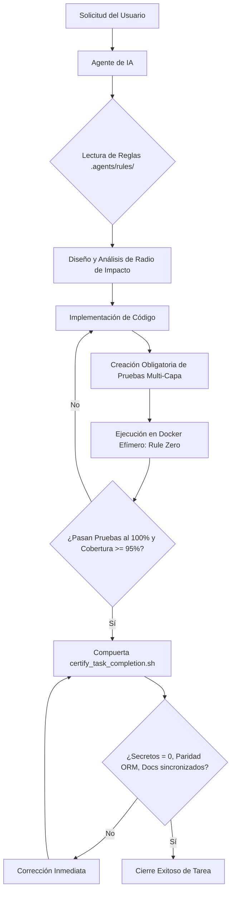

# 🤖 Arquitectura y Gobernanza de Agentes de Inteligencia Artificial (Nivel 11X)

> **PROPÓSITO:**  
> Este documento establece el estándar para orquestar, restringir y guiar a agentes de IA autónomos (Google Antigravity, Anthropic Claude Code / Claude Desktop, Hermes Agent de Nous Research, Cursor, Windsurf) en **Condominio App** para que operen como ingenieros Staff de QA y DevOps sin alucinaciones, sin deuda técnica y con total reproducibilidad.

---

## 1. De la Asistencia Pasiva a la Gobernanza Activa

Tratar a los modelos de lenguaje (LLMs) como simples autocompletadores de código genera código espagueti, mocks desconectados de la base de datos y regresiones silenciosas. En el estándar **11X**, el agente de IA es un operador autónomo sujeto a compuertas mecánicas estrictas:

---

## 2. La Estructura de Gobernanza `.agents/`

El directorio `.agents/` en la raíz de **Condominio App** implementa el estándar portable de gobernanza:

1. **`rules/` (Reglas de Cumplimiento Innegociable):**
   - `mandatory_qa_pyramid_and_doc_sync.md`
   - `secure_development_and_testing_guidelines.md`
   - `frontend_parity_and_closure.md`
   - `continuous_agent_evolution.md`
   - `anti_regression_and_side_effects_guardrail.md`
   - `ground_truth_fixtures_and_negative_invariants.md`
2. **`skills/` (Habilidades y Playbooks de Dominio):**
   - `qa-11x-docker-certifier`: Certificación en contenedores efímeros.
   - `docker-trivy-keydb-hardening`: Endurecimiento de contenedores y motor en memoria KeyDB Multi-Hilo.
   - `graphify-ast-navigator`: Navegación AST CLI-first y auditoría de radio de impacto.
3. **`scripts/` (Compuertas Automatizadas en CLI):**
   - `certify_task_completion.sh`
   - `verify_alembic_orm_parity.py`
   - `verify_zero_orphan_vue_components.py`
   - `verify_json_no_duplicate_keys.py`
   - `verify_topological_health.py`
   - `inspect_blast_radius.py`

---

## 3. Estrategia Lingüística y Optimización de Tokens ($\approx 35\%$ de Ahorro)

Implementamos una **estrategia bimodal deliberada**:
- Las reglas internas en `.agents/rules/` y `.agents/skills/` están en **inglés técnico de alta densidad**, ahorrando ~35% de la ventana de contexto en tokenizadores BPE y maximizando la adherencia lógica a estándares RFC/OWASP.
- Toda interacción con el equipo humano y toda la documentación del proyecto (`docs/`, `docs/specs/`, `CHANGELOG.md`, `ROADMAP.md`, `README.md`, `TESTING.md`, `SECURITY.md`) se genera estrictamente en **español** (`OUTPUT LANGUAGE CONSTRAINT`).

---

## 4. El Protocolo de Cierre Obligatorio (Closure Gate)

1. **Creación Obligatoria de Pruebas 11X:** Ningún código nuevo puede carecer de pruebas unitarias (`>= 95%`) ni de escenarios BDD en Karate Labs para API (`backend/test/api_test.feature`) y UI (`frontend/test/ui_business_flow.feature`).
2. **Ejecución en Docker Efímero (`Rule Zero`):** Toda la suite debe ejecutarse y pasar al 100% dentro de contenedores (`make -C backend qa-all`, `make -C frontend qa-all`).
3. **Sincronización Documental Continua:** Actualizar `docs/`, `docs/specs/`, `CHANGELOG.md` (bajo `## [Unreleased]`), `ROADMAP.md`, `TESTING.md` y `README.md`.
4. **Compuerta de Certificación:** Ejecutar `./.agents/scripts/certify_task_completion.sh` con salida en código 0.
