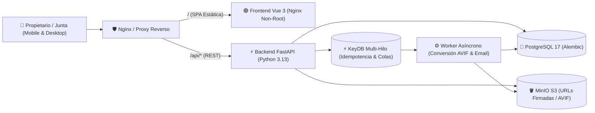

# 🔐 Especificación 01: Arquitectura de Sistema y Seguridad Nivel 11X

**Estado:** Activo y Certificado en Backend y Frontend (Hitos 1 al 7 Completados)  
**Estándar:** QA Testing Blueprints Nivel 11X

---

## 1. Topología de Servicios en Contenedores

---

## 2. Invariantes de Infraestructura y Persistencia

1. **Base de Datos Relacional (`PostgreSQL 17`):**
   - Esquema gestionado exclusivamente por migraciones versionadas en `backend/alembic/versions/`.
   - Verificación obligatoria sin mocks (`make -C backend qa-parity`) mediante `.agents/scripts/verify_alembic_orm_parity.py` y ejecución real de `alembic upgrade head && alembic downgrade base && alembic upgrade head`.
2. **Motor en Memoria (`KeyDB Multi-Hilo`):**
   - Imagen oficial `eqalpha/keydb:alpine` configurada con `--server-threads 2 --appendonly no --save "" --maxmemory 256mb --maxmemory-policy volatile-lru`.
   - 100% compatible con `redis.asyncio`, triplicando el rendimiento en bloqueos atómicos `SET NX EX` de `Idempotency-Key` y rotación de sesiones.
3. **Almacenamiento de Objetos (`MinIO` + Formato `AVIF`):**
   - Toda imagen subida (comprobantes de pago, facturas de egresos, evidencias de conserjería, fotos de voceros e incidencias) se procesa hacia formato **AVIF** con cuota máxima de entrada de **2 MB** (`HTTP 413`).

---

## 3. Contratos de Seguridad por Diseño (18 Vectores Mitigados y Especificados)

| # | Vector de Ataque | Mitigación Técnica en Condominio App | Ubicación en Código / Spec |
| :--- | :--- | :--- | :--- |
| 1 | **Mass Assignment (Over-posting)** | `model_config = ConfigDict(extra="forbid")` en todos los esquemas de entrada. | `backend/src/schemas.py`, `backend/src/routers/auth.py` |
| 2 | **Cross-Site WebSocket Hijacking (CSWSH)** | Validación de cabecera `Origin` contra `ALLOWED_ORIGINS` antes de `ws.accept()`. | `backend/src/security.py` (`verify_websocket_origin`) |
| 3 | **Fuga de Esquemas en Errores 422** | Respuesta opaca genérica cuando `APP_ENV=production` y registro interno en logs. | `backend/src/main.py` (`validation_exception_handler`) |
| 4 | **Server-Side Request Forgery (SSRF)** | Resolución DNS previa y bloqueo de hosts internos y rangos RFC 1918 / loopback / link-local. | `backend/src/security.py` (`validate_safe_outgoing_url`) |
| 5 | **Inyección SQL** | Consultas parametrizadas tipadas con SQLAlchemy 2.0 (`select`, `where`). | `backend/src/routers/*.py` |
| 6 | **Denegación de Servicio por Subida (OOM)** | Lectura por chunks de 64 KB con corte en 2 MB (`HTTP 413`) + validación cliente (`validateProofFileUpload`). | `backend/src/security.py`, `frontend/src/utils/security.ts` |
| 7 | **Cabeceras HTTP Inseguras** | Middleware inyectando `Cache-Control: no-store`, `X-Content-Type-Options: nosniff`, `X-Frame-Options: DENY`, `Referrer-Policy`. | `backend/src/main.py` (`security_headers_middleware`) |
| 8 | **CSRF y Autenticación Híbrida** | Tokens `HMAC-SHA256` (`generate_csrf_token`, `validate_csrf_token`) y soporte dual Cookie `HttpOnly` + `Authorization: Bearer`. | `backend/src/security.py`, `backend/src/dependencies.py` |
| 9 | **XSS, Open Redirect y Prototype Pollution en SPA** | `escapeHtml()`, `sanitizeUntrustedText()`, `isSafeRedirectUrl()` y `sanitizeObject()` con `Object.create(null)`. | `frontend/src/utils/security.ts` |
| 10 | **Esquemas Maliciosos en URLs de Adjuntos (XSS/LFI)** | Tipo Pydantic `UrlEvidenciaSegura` (`_validar_url_evidencia_segura`) que bloquea `javascript:`, `data:`, `vbscript:` y `file:` en comprobantes, facturas, fotos y evidencias. | `backend/src/schemas.py` |
| 11 | **Race Condition en Refresh Multi-Pestaña** | Ventana de cortesía (*grace period*) de 5s en KeyDB al rotar tokens. | `backend/src/redis_client.py` (`rotate_refresh_token_with_grace_period`) |
| 12 | **Colisión de Claves de Idempotencia** | Aislamiento por ámbito/usuario: `idemp:{scope}:{key}` + composable cliente `useIdempotency`. | `backend/src/redis_client.py`, `frontend/src/composables/useIdempotency.ts` |
| 13 | **Exposición de OpenAPI en Producción** | `docs_url=None`, `redoc_url=None`, `openapi_url=None` si `APP_ENV=production`. | `backend/src/main.py` |
| 14 | **CVEs en Cadena de Suministro** | `uv.lock`, `pnpm-lock.yaml`, `.npmrc` (`ignore-scripts=true`), `pnpm-workspace.yaml` (`allowBuilds`), `uv audit` y Trivy (`auditar-infra.sh`). | `backend/Makefile`, `frontend/pnpm-workspace.yaml`, `auditar-infra.sh` |
| 15 | **Falsificación de MIME Type en Uploads (*Magic Bytes*)** | Inspección binaria de los primeros 16 bytes (`%PDF-`, `\x89PNG`, `\xFF\xD8\xFF`, `RIFF....WEBP`, `....ftypavif`) dentro de `read_uploaded_file_safely`. | `backend/src/security.py` (`validate_file_magic_bytes`) |
| 16 | **Persistencia de Sesión Tras Desactivación o Fin de Contrato** | Lista de revocación en tiempo real en KeyDB (`revoked_user:{id}`) verificada en `get_current_user` al desactivar un usuario o revocar su cargo. | `backend/src/redis_client.py`, `backend/src/dependencies.py` |
| 17 | **Ataques de Repetición (*Replay*) en Pases QR y Adulteración de Votos/Solvencias** | Firma `HMAC-SHA256` en tiempo constante (`hmac.compare_digest`) + quema atómica de `nonce` (`SET qr_used:{jti} 1 NX EX {ttl}`) en KeyDB Multi-Hilo. | `docs/specs/07_...`, `docs/specs/08_...`, `docs/specs/09_...` |
| 18 | **Fraude por Reutilización de Comprobantes Bancarios** | Validación de unicidad sobre `(metodo, numero_referencia)` para pagos distintos de `EFECTIVO` y no `RECHAZADO` (`HTTP 409 Conflict`). | `backend/src/routers/pagos.py`, `docs/specs/07_...` |

---

## 4. Matriz Canónica de Alcances de Idempotencia (`idemp:{scope}:{key}`)

Toda operación de creación o mutación no idempotente exige la cabecera HTTP `Idempotency-Key` (entre 8 y 128 caracteres) y se aísla en **KeyDB Multi-Hilo** con TTL de 24 horas (`86400s`):

| Dominio | Endpoint | Formato de Alcance (`scope`) en KeyDB | Código en Reenvío Duplicado |
| :--- | :--- | :--- | :--- |
| Identidad | `POST /api/auth/register` | `idemp:register:{key}` | `409 Conflict` |
| Estructura | `POST /api/estructura/generar` | `idemp:estructura:{user_id}:{key}` | `409 Conflict` |
| Pagos | `POST /api/pagos/reportar` | `idemp:user:{user_id}:{key}` | `409 Conflict` |
| Incidencias | `POST /api/incidencias/crear` | `idemp:incidencia:{user_id}:{key}` | `409 Conflict` |
| Facturación LPH | `POST /api/finanzas/facturar-periodo` | `idemp:facturar:{periodo}:{key}` | `409 Conflict` |
| Fondos | `POST /api/finanzas/fondos` | `idemp:crear_fondo:{user_id}:{key}` | `409 Conflict` |
| Solvencia | `POST /api/finanzas/solvencia/{unidad_id}` | `idemp:solvencia:{unidad_id}:{key}` | `409 Conflict` |
| Cartas Consulta | `POST /api/consultas` | `idemp:crear_consulta:{user_id}:{key}` | `409 Conflict` |
| Votación LPH | `POST /api/consultas/{id}/votar` | `idemp:votar:{consulta_id}:{unidad_id}:{key}` | `409 Conflict` |
| Cierre Consulta | `POST /api/consultas/{id}/cerrar` | `idemp:cerrar_consulta:{consulta_id}:{key}` | `409 Conflict` |
| Accesos QR | `POST /api/accesos/pases` | `idemp:crear_pase:{user_id}:{key}` | `409 Conflict` |
| Escaneo Garita | `POST /api/accesos/verificar-qr` | `idemp:scan_qr:{user_id}:{key}` | `409 Conflict` |
| Paquetería | `POST /api/paqueteria/registrar` | `idemp:paquete:{user_id}:{key}` | `409 Conflict` |
| Reservas | `POST /api/reservas/solicitar` | `idemp:reservar:{unidad_id}:{key}` | `409 Conflict` |
