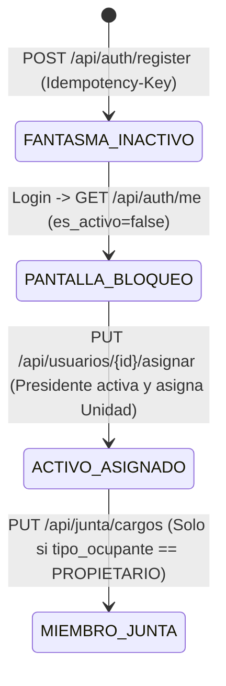

# 👥 Especificación 02: Dominio de Identidad, Estructura Polimórfica y RBAC

**Estado:** Hitos 1, 2, 4, 5 y 7 Completados y Certificados en Backend (`auth.py`, `administracion.py`) y GUI (`frontend/src/views/auth/`, `frontend/src/views/admin/`)

---

## 1. Modelo de Entidades de Identidad y Estructura

### 1.1. `Usuario` (`usuarios`)
- `id`: `Integer` PK
- `nombre`: `String` (indexado)
- `cedula`: `String` (único, indexado, ej. `V-12345678`)
- `correo`: `String` (único, indexado, validado RFC)
- `telefono`: `String`
- `password_hash`: `String` (`pbkdf2_sha256$<salt>$<digest>`)
- `es_activo`: `Boolean` (`False` por defecto al registrarse como Usuario Fantasma)
- `rol`: `String` (`FANTASMA` por defecto; valores válidos: `FANTASMA`, `PROPIETARIO`, `INQUILINO`, `PRESIDENTE`, `VICEPRESIDENTE`, `TESORERO`, `SECRETARIO`, `VOCERO`, `CONSERJE`)

### 1.2. `Estructura` (`estructuras`) y `Unidad` (`unidades`)
- Soporta agrupaciones polimórficas verticales y horizontales (`TipoEstructura = Literal["EDIFICIO", "TORRE", "BLOQUE", "MANZANA", "CALLE"]`).
- `Unidad.identificador`: `String` único (ej. `Apto 1-A`, `C1-12`).
- **Extensión Fase 4 ([Spec 07](./07_DOMINIO_ALICUOTAS_FACTURACION_Y_SOLVENCIA.md)):**
  - `Unidad.alicuota`: `Numeric(7, 4)` (`0.0000` a `100.0000%`), porcentaje legal de participación en gastos comunes y votaciones (Art. 7 LPH).
  - `Unidad.credito_disponible_usd`: `Numeric(12, 2)` (`>= 0.00`), saldo a favor acumulado por sobrepagos aprobados.

### 1.3. `ContratoOcupacion` (`contratos_ocupacion`)
- Mantiene el historial inmutable de quién habita o posee cada unidad a lo largo del tiempo:
  - `usuario_id`, `unidad_id`, `tipo_ocupante` (`PROPIETARIO` | `INQUILINO`), `es_activo`, `fecha_inicio`, `fecha_fin`.
- Nunca se sobrescribe un ocupante anterior; al cambiar de inquilino o propietario, se cierra el contrato previo (`es_activo = False`, `fecha_fin = now()`) y se inserta uno nuevo.
- **Extensión Fase 4 ([Spec 08](./08_DOMINIO_GOBERNANZA_CARTAS_CONSULTA_Y_ASAMBLEAS.md)):**
  - `puede_votar_asamblea`: `Boolean` (`True` para `PROPIETARIO`; `False` por defecto para `INQUILINO` salvo poder delegado registrado).
  - **Soporte Multi-Unidad y Revocación en KeyDB:** Un propietario con múltiples contratos activos puede alternar su `unidad_activa_id` en sesión, y cualquier desactivación de usuario o cierre de contrato inserta `revoked_user:{id}` en **KeyDB Multi-Hilo** para invalidar su JWT de forma inmediata.

---

## 2. Máquina de Estados: "Flujo de Usuario Fantasma"

### Reglas de Negocio Estrictas
1. **Bloqueo Total del Usuario Fantasma:** Mientras `es_activo == False` o `rol == "FANTASMA"`, el usuario autenticado **solo** puede consultar `GET /api/auth/me` y cerrar sesión. En el Frontend Vue 3, el Navigation Guard global redirige forzosamente cualquier ruta hacia `/espera-aprobacion`.
2. **Condición de Junta de Condominio:** Únicamente usuarios con contrato activo donde `tipo_ocupante == "PROPIETARIO"` pueden ser designados como `PRESIDENTE`, `VICEPRESIDENTE`, `TESORERO`, `SECRETARIO` o `VOCERO`. Los inquilinos no pueden integrar la Junta.
3. **Matriz de Control de Acceso Basado en Roles (RBAC):**
   - **Presidente / Vicepresidente:** Generan estructuras/unidades (`POST /api/estructura/generar`), aprueban Usuarios Fantasma (`GET /api/usuarios/pendientes`, `PUT /api/usuarios/{id}/asignar`), crean plantillas y asignan tareas al conserje (`POST /api/tareas/plantillas`, `POST /api/tareas/diarias`).
   - **Presidente (Exclusivo):** Asigna cargos de Junta de Condominio (`PUT /api/junta/cargos`).
   - **Tesorero y Presidente:** Autorizados para registrar tasas BCV (`POST /api/finanzas/tasa`), registrar egresos (`POST /api/finanzas/egresos`), revisar/aprobar/rechazar pagos (`GET /api/pagos/revision`, `PUT /api/pagos/{id}/aprobar`, `PUT /api/pagos/{id}/rechazar`) y ejecutar el cierre mensual (`POST /api/finanzas/cierre-mensual`).

---

## 3. Contratos de Endpoints del Dominio

| Método y Ruta | Rol Requerido | Cabeceras | Descripción y Reglas |
| :--- | :--- | :--- | :--- |
| `POST /api/auth/register` | Público | `Idempotency-Key` | Crea `Usuario` (`es_activo=False`, `rol="FANTASMA"`) y solicitud en `ContratoOcupacion`. Rechaza campos extra (`extra="forbid"`). |
| `POST /api/auth/login` | Público | — | Verifica `PBKDF2-HMAC-SHA256` y emite JWT en cookie `HttpOnly; Secure; SameSite=Lax`. |
| `GET /api/auth/me` | Autenticado | Cookie / Bearer | Devuelve `{id, correo, nombre, rol, es_activo}`. |
| `GET /api/estructura/unidades` | Público / Auth | — | Lista unidades disponibles para el selector de registro y panel de estructura. |
| `POST /api/estructura/generar` | `PRESIDENTE`, `VICEPRESIDENTE` | `Idempotency-Key` | Crea sector (`EDIFICIO`, `TORRE`, `BLOQUE`, `MANZANA`, `CALLE`) y autogenera sus unidades. |
| `GET /api/usuarios/pendientes` | `PRESIDENTE`, `VICEPRESIDENTE` | Cookie / Bearer | Lista usuarios con `es_activo == False`. |
| `PUT /api/usuarios/{id}/asignar` | `PRESIDENTE`, `VICEPRESIDENTE` | Cookie / Bearer | Activa usuario (`es_activo=True`), asigna rol RBAC y activa `ContratoOcupacion`. |
| `PUT /api/junta/cargos` | `PRESIDENTE` | Cookie / Bearer | Asigna cargos de Junta validando que el usuario sea `PROPIETARIO` con unidad activa. |
