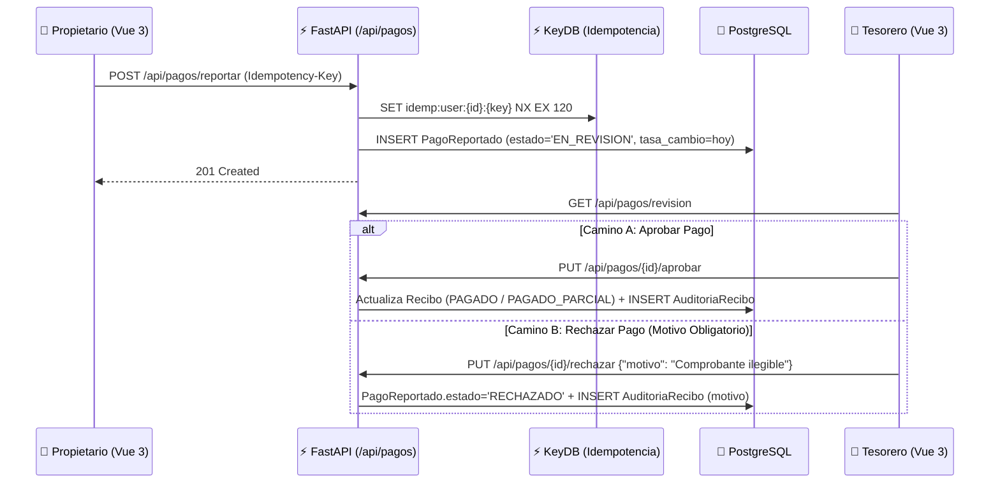

# 💰 Especificación 03: Dominio de Finanzas, Cobranzas y Candado Contable

**Estado:** Backend Completado (Hito 3 ✅ con 99.66% cobertura) / GUI en Hito 6

---

## 1. Principios del Core Matemático (`backend/src/finanzas.py`)

1. **Moneda Base Contable:** Toda deuda, recibo y balance consolidado se referencia en **USD** (`Numeric(12, 2)`), con redondeo bancario determinista `ROUND_HALF_UP` a dos decimales (`0.01`).
2. **Tasa de Cambio Exacta del Día (`TasaCambio`):**
   - Al reportar un pago en `VES` o registrar un egreso en `VES`, el sistema consulta la tasa `USD/VES` (`Numeric(14, 4)`) registrada para `date.today()`.
   - Si no existe tasa para el día, devuelve `HTTP 400 Bad Request` (`"La tasa de cambio del día no ha sido registrada"`).
   - El registro `PagoReportado` o `Egreso` congela de forma inmutable el valor `tasa_cambio` y `monto_usd` calculados en ese instante.
3. **Referencia Obligatoria por Método de Pago:**
   - Métodos `ZELLE`, `PAGO_MOVIL` y `TRANSFERENCIA` exigen `numero_referencia` no vacío (`HTTP 400` si se omite o contiene solo espacios).
   - Método `EFECTIVO` permite `numero_referencia = None`.
4. **Frontera Matemática de Pago Parcial vs Total:**
   - `monto_pagado_usd == 0` -> `PENDIENTE`
   - `0 < monto_pagado_usd < monto_usd` -> `PAGADO_PARCIAL`
   - `monto_pagado_usd >= monto_usd` -> `PAGADO`
   - `calcular_saldo_pendiente(monto_usd, monto_pagado_usd)` nunca devuelve valores negativos (`max(0.00, monto - pagado)`).

---

## 2. Flujo de Aprobación, Rechazo y Pista de Auditoría (`AuditoriaRecibo`)

---

## 3. El Candado Contable (`POST /api/finanzas/cierre-mensual`)

1. **Inmutabilidad Absoluta:**
   - Cuando se ejecuta `POST /api/finanzas/cierre-mensual` para un `periodo` (`YYYY-MM`), todos los `Recibo` y `Egreso` de ese periodo pasan a `bloqueado = True`, y `ReporteMensual` pasa a `estado = "CERRADO"` con timestamp `cerrado_en`.
   - Si se intenta volver a cerrar un periodo ya cerrado, devuelve `HTTP 409 Conflict` (`"El mes ya fue cerrado (acción inmutable)"`).
   - Si se intenta reportar, aprobar o rechazar un pago asociado a un recibo con `bloqueado == True`, devuelve `HTTP 409 Conflict` (`"El periodo está cerrado (Candado Contable)"`).
2. **Comportamiento en la GUI (Hito 6):**
   - Del día 1 al 10 de cada mes, el Dashboard (`/dashboard`) muestra un Banner destacado si existe un cierre disponible.
   - En las vistas de Tesorería, cualquier recibo o egreso con `bloqueado == True` deshabilita visualmente los botones de mutación y muestra el sello `"🔒 Mes Cerrado"`.
