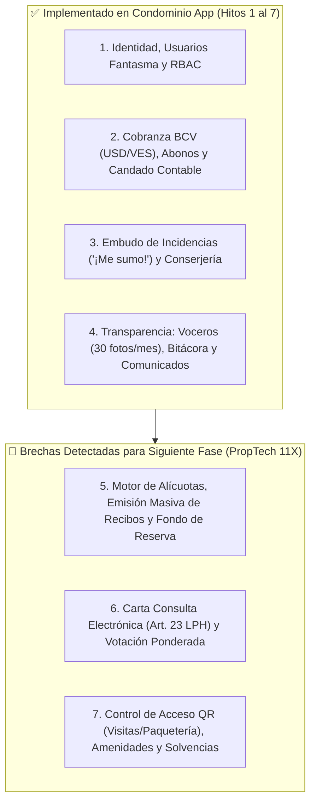

# 📊 Especificación 06: Informe de Investigación PropTech (Propiedad Horizontal), Auditoría de Consistencia Código ↔ Specs y Hoja de Ruta Evolutiva (Nivel 11X)

**Fecha:** 2026-10-30  
**Alcance:** Auditoría de consistencia `backend/` + `frontend/` contra `docs/specs/01..05`, investigación de sistemas modernos de administración de condominios (Latinoamérica / Ley de Propiedad Horizontal de Venezuela / HOA Global 2025–2026) y arquitectura de los próximos módulos.

---

## 1. Auditoría de Consistencia Código ↔ Specs y Endurecimiento Aplicado

Durante la auditoría cruzada entre las especificaciones `01..05` y el código fuente de `backend/src/` y `frontend/src/`, se identificaron y corrigieron de inmediato **4 brechas de consistencia y seguridad**:

| # | Hallazgo en Auditoría Cruzada | Riesgo Mitigado | Corrección Aplicada en Código y Specs |
| :--- | :--- | :--- | :--- |
| 1 | **Falta de verificación RBAC y bloqueo de Usuarios Fantasma en `finanzas.py` y `pagos.py`** | Un Usuario Fantasma (`es_activo=False`, `rol="FANTASMA"`) o un vecino sin rol de Tesorería podía invocar directamente `POST /api/finanzas/tasa`, `POST /api/finanzas/cierre-mensual` o `PUT /api/pagos/{id}/aprobar` omitiendo la GUI. | Se inyectó `verificar_usuario_activo(usuario)` en `GET /api/finanzas/tasa`, `GET /api/finanzas/resumen` y `POST /api/pagos/reportar`, y `verificar_roles(usuario, ("TESORERO", "PRESIDENTE"))` en `POST /api/finanzas/tasa`, `POST /api/finanzas/egresos`, `POST /api/finanzas/cierre-mensual`, `GET /api/pagos/revision`, `PUT /api/pagos/{id}/aprobar` y `PUT /api/pagos/{id}/rechazar`. |
| 2 | **Validación de esquemas de URL en evidencias/adjuntos (`url_comprobante`, `url_factura`, `url_foto`, `url_evidencia`)** | Un atacante podía inyectar URIs `javascript:alert(1)`, `data:text/html,...` o `file:///etc/passwd` en campos de evidencia fotográfica o comprobantes. | Se creó el tipo anotado `UrlEvidenciaSegura` (`_validar_url_evidencia_segura`) en `backend/src/schemas.py`, aceptando únicamente `https://`, `http://`, `s3://` o rutas relativas `/` y bloqueando `javascript:`, `data:`, `vbscript:` y `file:`. |
| 3 | **Asimetría de tipos `TipoEstructura` y `RolResidente` entre Backend y Frontend** | `AdminStructureView.vue` permitía `TORRE`, `BLOQUE` y `MANZANA`, mientras `backend/src/schemas.py` solo admitía `EDIFICIO` y `CALLE`. Asimismo, `AdminGhostUsersView.vue` permitía asignar roles directivos al activar cuenta. | Se unificó `TipoEstructura = Literal["EDIFICIO", "TORRE", "BLOQUE", "MANZANA", "CALLE"]` y `RolResidente` entre `backend/src/schemas.py`, `frontend/src/stores/operationsStore.ts` y `02_DOMINIO_IDENTIDAD_ESTRUCTURA_Y_RBAC.md`. |
| 4 | **Sincronización de rutas y estados en `docs/specs/README.md` y `01..05`** | El mapa de trazabilidad citaba `POST /api/comunicados/crear` en lugar de `POST /api/comunicados` y estados previos a los Hitos 6 y 7. | Se actualizaron `docs/specs/README.md` y las especificaciones `01` a `05` con los 14 vectores de seguridad y selectores canónicos de Hito 7. |

---

## 2. Investigación de Mercado y Marco Legal: ¿Qué debe tener un Sistema Moderno de Administración de Condominios?

Del análisis comparativo de las plataformas líderes en Latinoamérica y el mundo (*ComunidadFeliz, EdiPro, Neivor, Habitanto, Vivook, CondoVive, Buildium, Vantaca*) junto con las exigencias de la **Ley de Propiedad Horizontal (LPH) en Venezuela y LATAM**, un sistema de clase mundial se compone de **7 pilares funcionales**:

---

## 3. ¿Qué Falta en Condominio App y Cómo Debe Diseñarse (Arquitectura 11X)?

### 3.1. Módulo A: Motor de Alícuotas, Facturación Mensual Automatizada y Fondo de Reserva
- **Qué falta:** Actualmente los `Recibo` existen en base de datos y los `Egreso` se registran por categoría, pero no existe el motor automático que al cerrar o pre-liquidar el mes sume los gastos comunes, aplique el porcentaje de **Fondo de Reserva** (ej. 10%) y distribuya la cuota de cada unidad según su **Alícuota de Copropiedad** ($\text{Cuota}_i = \text{GastoTotal} \times \frac{\text{Alícuota}_i}{100}$).
- **Cómo debe hacerse (Diseño Seguro 11X):**
  1. **Columna `alicuota` en `unidades`:** `Numeric(6, 4)` (ej. `1.2500` para $1.25\%$). Invariante matemática: la suma de alícuotas de una estructura no puede superar `100.0000%` y toda cuenta debe usar `Decimal` con `ROUND_HALF_UP` (prohibido `float`).
  2. **Contabilidad Separada por Fondos (`FondoContable`):** Separar estrictamente el **Fondo Operativo** del **Fondo de Reserva** y **Cuotas Extraordinarias**, impidiendo que gastos corrientes consuman el Fondo de Reserva sin autorización de Junta/Asamblea.
  3. **Endpoint Idempotente `POST /api/finanzas/emitir-recibos`:** Genera en lote los recibos del periodo `YYYY-MM` desglosando cada egreso, el aporte al Fondo de Reserva y el monto individual según la alícuota de cada inmueble, protegido con `Idempotency-Key` y `UniqueConstraint("unidad_id", "periodo")`.

### 3.2. Módulo B: Carta Consulta Electrónica y Asambleas Virtuales (Art. 23 LPH)
- **Qué falta:** Las decisiones críticas (aprobación de presupuestos mayores, cuotas extraordinarias, elección de Junta) requieren **Carta Consulta** escrita o votación ponderada por alícuota.
- **Cómo debe hacerse (Diseño Seguro 11X):**
  1. **Tablas `consultas` y `votos_consulta`:** Cada voto registra `consulta_id`, `unidad_id`, `usuario_id`, `opcion` (`A_FAVOR`, `EN_CONTRA`, `ABSTENCION`), `alicuota_congelada` y un **sello criptográfico `HMAC-SHA256`** (`firma_voto = HMAC(SECRET, consulta_id | unidad_id | opcion | timestamp)`) para garantizar no repudio e inmutabilidad.
  2. **Restricción Legal RBAC:** Solo el `PROPIETARIO` activo de la unidad puede emitir voto en una Carta Consulta (los `INQUILINO` tienen acceso de lectura pero no derecho a voto dominial), con `UniqueConstraint("consulta_id", "unidad_id")` (un voto por inmueble, ponderado por su alícuota).
  3. **Cómputo de Quórum en Tiempo Real:** Barra de progreso mostrando tanto el número de unidades participantes como el porcentaje de alícuota alcanzado frente al umbral legal ($66.67\%$ o $75\%$).

### 3.3. Módulo C: Control de Acceso con Pases QR Firmados y Bitácora de Portería / Paquetería
- **Qué falta:** La garita o conserjería necesita validar visitantes autorizados y registrar la recepción de paquetes/encomiendas sin depender de cuadernos de papel ni grupos de WhatsApp.
- **Cómo debe hacerse (Diseño Seguro 11X):**
  1. **Pases de Visita QR con Firma Efímera (`HMAC-SHA256`):** El residente genera desde su móvil un pase para su visitante con ventana de validez (`valido_desde`, `valido_hasta`). El código QR contiene un token firmado que el `CONSERJE` escanea o verifica en `/operaciones/accesos` sin exponer datos sensibles de otros residentes.
  2. **Módulo de Paquetería (`correspondencia`):** El conserje registra la llegada de un paquete con foto AVIF (`<= 2 MB`), el sistema notifica al residente y registra la entrega con marca de tiempo y confirmación.

### 3.4. Módulo D: Reserva de Áreas Comunes (Amenidades) Vinculada a Solvencia
- **Qué falta:** Calendario para reservar salón de fiestas, parrillera o canchas deportivas.
- **Cómo debe hacerse (Diseño Seguro 11X):**
  1. **Verificación Automática de Solvencia:** Antes de confirmar `POST /api/amenidades/reservar`, el backend verifica que la unidad del solicitante no posea recibos vencidos pendientes (o según umbral configurable por la Junta), devolviendo `HTTP 409 Conflict` si existe morosidad.
  2. **Prevención de Colisiones de Horario:** Bloqueo transaccional e `Idempotency-Key` para impedir reservas solapadas sobre la misma área y fecha.

### 3.5. Módulo E: Certificado Digital de Solvencia de Condominio Verificable
- **Qué falta:** Emisión instantánea de la **Solvencia de Condominio** cuando el propietario está al día (`saldo_pendiente == 0.00`), indispensable para trámites legales, alquileres o compraventa.
- **Cómo debe hacerse (Diseño Seguro 11X):**
  1. **Endpoint `GET /api/finanzas/solvencia/{unidad_id}`:** Verifica que todos los recibos emitidos para la unidad tengan `estado == "PAGADO"`. Si debe siquiera `$0.01`, rechaza la emisión con `HTTP 409 Conflict` detallando los periodos pendientes.
  2. **Sello de Verificación Anti-Forja:** Incluye un código único verificable firmando `unidad_id + periodo_hasta + fecha_emision` con `HMAC-SHA256`.

---

## 4. Mejoras Recomendadas sobre los Módulos Ya Existentes

1. **Finanzas y Cobranzas (`backend/src/routers/finanzas.py`, `pagos.py` y `frontend/src/views/finance/`):**
   - **Bloqueo de Egresos en Periodos Cerrados:** Impedir el alta de nuevos `Egreso` sobre un `periodo` cuyo `ReporteMensual` ya tenga `estado == "CERRADO"` (extendiendo el Candado Contable también a `POST /api/finanzas/egresos`).
   - **Sincronización Automática / Histórica de Tasa BCV:** Añadir consulta de tasa por fecha efectiva del pago (`fecha_pago`) además de `date.today()`, ya que un vecino puede reportar hoy una transferencia en `VES` ejecutada el día hábil anterior.
   - **Filtro de Recibos por Unidad Propia:** En el Wizard de Pagos (`/finanzas/reportar-pago`), cargar dinámicamente desde un endpoint `GET /api/finanzas/mis-recibos` los recibos pendientes de las unidades asociadas al `ContratoOcupacion` activo del usuario autenticado.
2. **Operaciones e Incidencias (`backend/src/routers/incidencias.py`, `operaciones.py`):**
   - **Transición de Estado y Comentarios de Cierre:** Permitir que el Presidente/Conserje agregue una nota técnica de resolución y foto del "después" al cerrar una incidencia, visible para todos los vecinos que pulsaron `"¡Me sumo!"`.
   - **Paginación Basada en Cursores (`limit` / `cursor`):** Añadir paginación acotada (`limit <= 50`) en `GET /api/bitacora/historial`, `GET /api/incidencias/abiertas` y `GET /api/pagos/revision` para evitar respuestas masivas a medida que el historial crezca durante años.
3. **Identidad y Seguridad (`backend/src/routers/auth.py`, `administracion.py`):**
   - **Cierre Automático de Contratos Previos:** Al asignar un nuevo `PROPIETARIO` a una unidad en `PUT /api/usuarios/{id}/asignar`, marcar automáticamente `es_activo = False` y `fecha_fin = now()` en el contrato del propietario anterior de esa misma unidad para preservar la trazabilidad histórica sin solapamientos.
   - **Rate Limiting por IP y Cuenta en `/api/auth/login`:** Respaldar el login con un contador atómico en **KeyDB Multi-Hilo** (`login_attempts:{ip}:{correo}`, máx. 5 intentos fallidos cada 15 minutos -> `HTTP 429 Too Many Requests`) contra ataques de fuerza bruta y *credential stuffing*.
   - **Endpoint de Cierre de Sesión (`POST /api/auth/logout`):** Limpiar explícitamente la cookie `HttpOnly` `access_token` en el servidor además de limpiar el store de Pinia en el cliente.
