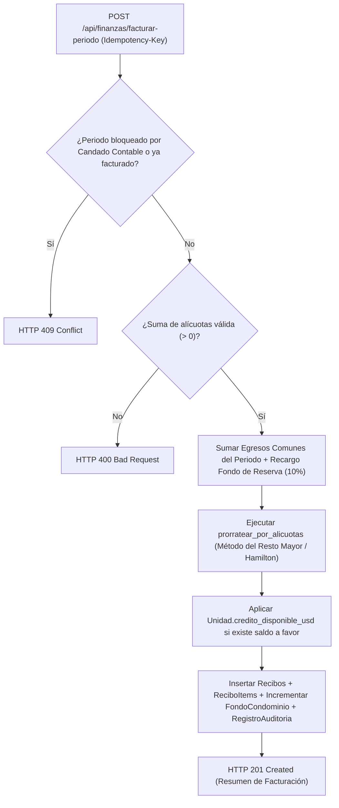

# 💰 Especificación 07: Dominio de Alícuotas, Facturación Mensual (Recibo LPH), Fondos y Solvencia Digital

**Estado:** `[ESPECIFICADO — FASE 4 / HITO 10]`  
**Módulos Backend Objetivo:** `backend/src/models.py`, `backend/src/schemas.py`, `backend/src/finanzas.py`, `backend/src/routers/finanzas.py`, `backend/src/routers/pagos.py`, `backend/alembic/versions/0003_hito10_alicuotas_solvencia.py`  
**Módulos Frontend Objetivo:** `frontend/src/stores/financeStore.ts`, `frontend/src/views/finance/BillingGeneratorView.vue`, `frontend/src/views/finance/SolvencyCertificateView.vue`, `frontend/src/components/finance/ReceiptBreakdownModal.vue`

---

## 1. Propósito y Fundamento Legal (Art. 7, 11 y 14 LPH)

En un régimen de Propiedad Horizontal (como la *Ley de Propiedad Horizontal* de Venezuela y legislaciones homólogas en Latinoamérica), los recibos de condominio **no** son montos arbitrarios ni se dividen en partes iguales cuando existen apartamentos o casas de distinto metraje. Todo el ciclo contable nace de tres pilares legales:
1. **Alícuota de Copropiedad (Art. 7 LPH):** Porcentaje de participación ($\text{NUMERIC}(7, 4)$, p. ej. $1.2500\%$) asignado a cada `Unidad` en el Documento de Condominio, cuya suma total en el inmueble debe ser exactamente $100.0000\%$.
2. **Gastos Comunes y Fondo de Reserva (Art. 11 LPH):** Los gastos comunes del periodo (`egresos`) más el recargo porcentual destinado al **Fondo de Reserva** (típicamente $10.00\%$) y fondos especiales se prorratean entre todas las unidades en proporción exacta a su alícuota.
3. **Certificado de Solvencia de Condominio (Art. 14 LPH):** Documento probatorio exigido en notarías, registros subalternos y administraciones para autorizar compraventas, mudanzas o alquileres, certificando que la unidad tiene deuda cero ($0.00\text{ USD}$).

---

## 2. Evolución del Modelo de Datos (SQLAlchemy 2.0 + PostgreSQL 17)

### 2.1. Extensión de `Unidad` (`unidades`) y `Egreso` (`egresos`)
| Tabla | Columna Nueva | Tipo SQL | Restricciones | Propósito |
| :--- | :--- | :--- | :--- | :--- |
| `unidades` | `alicuota` | `NUMERIC(7, 4)` | `NOT NULL DEFAULT 0.0000`, `CHECK (alicuota >= 0 AND alicuota <= 100)` | Porcentaje de participación de la unidad en los gastos comunes y votaciones (p. ej. `Decimal("1.2500")`). |
| `unidades` | `credito_disponible_usd` | `NUMERIC(12, 2)` | `NOT NULL DEFAULT 0.00`, `CHECK (credito_disponible_usd >= 0)` | Saldo a favor acumulado por sobrepagos aprobados, descontable automáticamente en la siguiente facturación mensual. |
| `egresos` | `incidencia_id` | `INTEGER` | `FOREIGN KEY (incidencias.id) NULL` | Vinculación opcional de trazabilidad entre un gasto de reparación y la incidencia vecinal que lo originó. |
| `egresos` | `es_gasto_comun` | `BOOLEAN` | `NOT NULL DEFAULT TRUE` | Si es `True`, se incluye en el prorrateo mensual por alícuota; si es `False`, corresponde a un cargo individual o ejecución contra fondo acumulado. |

### 2.2. Índice Único Anti-Fraude en `PagoReportado` (`pagos_reportados`)
Para impedir que dos unidades distintas (o la misma unidad en meses distintos) reutilicen el mismo comprobante bancario (`PAGO_MOVIL`, `TRANSFERENCIA`, `ZELLE`):
- Se incorpora validación de negocio y restricción de unicidad lógica sobre `(metodo, numero_referencia)` para todo pago cuyo `metodo != 'EFECTIVO'` y `estado != 'RECHAZADO'`.
- Si un usuario intenta reportar una referencia bancaria ya registrada en estado `EN_REVISION` o `APROBADO`, el endpoint responde `HTTP 409 Conflict` (`"El número de referencia bancaria ya fue registrado previamente"`).

### 2.3. Nuevas Entidades ORM

#### A. `FondoCondominio` (`fondos_condominio`)
Representa los fondos patrimoniales del condominio (Fondo de Reserva Legal, Caja Chica, Fondo de Contingencia Hidroneumático/Ascensores).
- `id`: `INTEGER PRIMARY KEY`
- `nombre`: `VARCHAR(100) UNIQUE NOT NULL` (ej. `"Fondo de Reserva Legal"`)
- `tipo`: `VARCHAR(30) NOT NULL` (`"RESERVA_LEGAL" | "CAJA_CHICA" | "ESPECIAL"`)
- `porcentaje_recargo`: `NUMERIC(5, 2) NOT NULL DEFAULT 10.00` (porcentaje que se añade sobre los gastos comunes en cada facturación mensual, ej. `10.00` para 10%)
- `saldo_actual_usd`: `NUMERIC(14, 2) NOT NULL DEFAULT 0.00`
- `es_activo`: `BOOLEAN NOT NULL DEFAULT TRUE`

#### B. `ReciboItem` (`recibos_items`)
Desglose línea por línea de cada `Recibo` emitido (transparencia contable en el Recibo de Condominio):
- `id`: `INTEGER PRIMARY KEY`
- `recibo_id`: `INTEGER FOREIGN KEY (recibos.id) ON DELETE CASCADE NOT NULL`
- `tipo_item`: `VARCHAR(30) NOT NULL` (`"GASTO_COMUN" | "FONDO_RESERVA" | "CUOTA_EXTRAORDINARIA" | "CARGO_INDIVIDUAL" | "ABONO_CREDITO_PREVIO"`)
- `descripcion`: `VARCHAR(255) NOT NULL`
- `monto_usd`: `NUMERIC(12, 2) NOT NULL` (positivo para cargos, negativo únicamente para `"ABONO_CREDITO_PREVIO"`)

#### C. `CertificadoSolvencia` (`certificados_solvencia`)
Registro auditable e inmutable de certificados de solvencia emitidos:
- `id`: `INTEGER PRIMARY KEY`
- `folio`: `VARCHAR(40) UNIQUE NOT NULL` (ej. `"SOLV-202610-00014"`)
- `unidad_id`: `INTEGER FOREIGN KEY (unidades.id) NOT NULL`
- `emitido_por_id`: `INTEGER FOREIGN KEY (usuarios.id) NOT NULL`
- `fecha_emision`: `TIMESTAMP WITH TIME ZONE NOT NULL`
- `fecha_vencimiento`: `DATE NOT NULL` (fin del mes en curso)
- `deuda_verificada_usd`: `NUMERIC(12, 2) NOT NULL DEFAULT 0.00` (`CHECK (deuda_verificada_usd = 0.00)`)
- `firma_hmac`: `VARCHAR(64) NOT NULL` (hex digest `HMAC-SHA256`)

---

## 3. Núcleo Matemático Puro (`src/finanzas.py`): Método del Resto Mayor (Hamilton)

### 3.1. El Problema del Redondeo en Prorrateo Contable
Cuando un gasto común total $G$ (por ejemplo, $\$100.00\text{ USD}$) se divide entre 3 unidades con alícuotas iguales ($33.3333\%$), el redondeo individual `ROUND_HALF_UP` produce tres recibos de $\$33.33\text{ USD}$, cuya suma es $\$99.99\text{ USD}$, generando un descuadre contable de $-\$0.01\text{ USD}$ frente a los egresos reales.

### 3.2. Algoritmo Determinista `prorratear_por_alicuotas` (Penny Allocation)
Todas las funciones en `src/finanzas.py` son funciones puras libres de I/O que operan exclusivamente con `decimal.Decimal`:

1. **Validación de Invariante de Alícuotas:**
   - `validar_suma_alicuotas(alicuotas: Sequence[Decimal]) -> bool`: Verifica que $\sum_{i=1}^{N} a_i == \text{Decimal}("100.0000")$ (con tolerancia máxima configurable de $\pm 0.0100\%$ solo si el Documento de Condominio histórico presenta truncamiento notarial, normalizando sobre la suma total de pesos $\sum a_i$).
2. **Cálculo en Centavos Enteros y Resto Mayor (Hamilton / Hare-Niemeyer):**
   - Sea $T_{\text{cents}} = \text{int}(\text{monto\_total\_usd} \times 100)$ el total exacto en centavos y $W = \sum_{i=1}^{N} a_i$.
   - Para cada unidad $i$ (ordenada determinísticamente por `unidad_id` ascendente):
     - Cuota exacta en centavos: $q_i = \frac{T_{\text{cents}} \times a_i}{W}$.
     - Cuota piso entera: $f_i = \lfloor q_i \rfloor$ (`ROUND_DOWN`).
     - Residuo fraccionario: $r_i = q_i - f_i$.
   - Centavos restantes por distribuir: $R = T_{\text{cents}} - \sum_{i=1}^{N} f_i$ (donde siempre se cumple $0 \le R < N$).
   - Se ordenan las unidades por $(-r_i, \text{unidad\_id})$ y se suma $+1\text{ centavo}$ a las primeras $R$ unidades.
   - **Post-condición Garantizada (Invariante 11X):**
     $$\sum_{i=1}^{N} \text{cuota\_usd}_i == \text{monto\_total\_usd}$$
3. **Aplicación Automática de Saldo a Favor (`aplicar_credito_disponible`):**
   - Si una unidad posee `credito_disponible_usd > 0`, al emitir su recibo del periodo se genera un `ReciboItem` de tipo `"ABONO_CREDITO_PREVIO"` por $-\min(\text{credito\_disponible\_usd}, \text{cargo\_bruto\_usd})$.
   - Si el crédito cubre el $100\%$ del recibo, el recibo nace directamente con `estado = "PAGADO"` y `monto_pagado = monto_total`.
4. **Acreditación de Sobrepagos al Aprobar Pagos (`PUT /api/pagos/{id}/aprobar`):**
   - Si el `monto_usd_equivalente` de un pago aprobado supera el `saldo_pendiente` del recibo, el recibo queda en `estado = "PAGADO"` (`monto_pagado = monto_total`) y el excedente exacto ($\text{excedente} = \text{pago} - \text{saldo\_pendiente}$) se suma atómicamente a `Unidad.credito_disponible_usd`, registrando el evento en `RegistroAuditoria`.



---

## 4. Firma Criptográfica de Certificados de Solvencia (`HMAC-SHA256`)

1. **Regla Estricta de Emisión:**
   - Una unidad es **SOLVENTE** sí y solo sí no posee ningún `Recibo` en estado `"PENDIENTE"` ni `"PARCIAL"` ($\sum \text{saldo\_pendiente} == \text{Decimal}("0.00")$).
   - Si presenta deuda $\ge \$0.01\text{ USD}$, el endpoint `POST /api/finanzas/solvencia/{unidad_id}` rechaza la solicitud con `HTTP 409 Conflict` indicando el monto exacto adeudado y los periodos pendientes.
2. **Construcción del Sello Criptográfico:**
   - Mensaje canónico:
     $$\text{payload} = \text{"SOLV|v1|"} \parallel \text{folio} \parallel \text{"|"} \parallel \text{identificador\_unidad} \parallel \text{"|"} \parallel \text{fecha\_vencimiento\_iso} \parallel \text{"|0.00"}$$
   - Firma:
     $$\text{firma\_hmac} = \text{HMAC-SHA256}(\text{JWT\_SECRET\_KEY}, \text{payload})$$
   - El código QR impreso en el certificado contiene el token `base64url(payload) + "." + firma_hmac`, verificable en tiempo constante (`hmac.compare_digest`) mediante `GET /api/finanzas/solvencia/verificar/{folio}?sig={firma_hmac}`.

---

## 5. Contratos de Endpoints REST e Idempotencia (`backend/src/routers/finanzas.py`)

| Método | Ruta | Rol Requerido | Alcance `Idempotency-Key` | Descripción y Códigos de Respuesta |
| :--- | :--- | :--- | :--- | :--- |
| `PUT` | `/api/estructura/unidades/{unidad_id}/alicuota` | `PRESIDENTE`, `TESORERO` | `idemp:alicuota:{unidad_id}:{key}` | Actualiza la alícuota de una unidad (`200 OK`, `404 Not Found`, `422 Unprocessable Entity`). |
| `POST` | `/api/finanzas/fondos` | `PRESIDENTE`, `TESORERO` | `idemp:crear_fondo:{user_id}:{key}` | Crea un `FondoCondominio` (`201 Created`, `409 Conflict` si el nombre o clave de idempotencia ya existe). |
| `GET` | `/api/finanzas/fondos` | Usuario Activo | N/A (`GET`) | Lista los fondos patrimoniales activos, su porcentaje de recargo y su `saldo_actual_usd` (`200 OK`). |
| `POST` | `/api/finanzas/facturar-periodo` | `PRESIDENTE`, `TESORERO` | `idemp:facturar:{periodo}:{key}` | Genera de forma atómica los `Recibo` y `ReciboItem` de todas las unidades para un `periodo` (`YYYY-MM`). Devuelve `409 Conflict` si el periodo ya fue facturado o cerrado por Candado Contable (`201 Created`). |
| `GET` | `/api/finanzas/recibos/{recibo_id}/desglose` | Usuario Activo (Propietario de la unidad o Junta) | N/A (`GET`) | Retorna el recibo junto con sus líneas `ReciboItem`, alícuota aplicada y crédito descontado (`200 OK`, `403 Forbidden`, `404 Not Found`). |
| `POST` | `/api/finanzas/solvencia/{unidad_id}` | `PRESIDENTE`, `TESORERO` o Propietario solvente de la unidad | `idemp:solvencia:{unidad_id}:{key}` | Verifica deuda cero ($0.00\text{ USD}$) y emite un `CertificadoSolvencia` firmado con `HMAC-SHA256` (`201 Created`, `403 Forbidden`, `409 Conflict` si existe deuda). |
| `GET` | `/api/finanzas/solvencia/verificar/{folio}` | Público / Conserjería / Junta | N/A (`GET`) | Verifica en tiempo constante la autenticidad y vigencia del folio y su firma `sig` (`200 OK`, `400 Bad Request` si firma inválida, `404 Not Found`). |

---

## 6. Especificación de Esquemas Pydantic (`ConfigDict(extra="forbid")`)

```python
class FondoCondominioCreate(BaseModel):
    model_config = ConfigDict(extra="forbid")
    nombre: str = Field(..., min_length=3, max_length=100)
    tipo: Literal["RESERVA_LEGAL", "CAJA_CHICA", "ESPECIAL"] = "RESERVA_LEGAL"
    porcentaje_recargo: Decimal = Field(default=Decimal("10.00"), ge=Decimal("0.00"), le=Decimal("100.00"))

class FacturarPeriodoRequest(BaseModel):
    model_config = ConfigDict(extra="forbid")
    periodo: str = Field(..., pattern=r"^\d{4}-(0[1-9]|1[0-2])$")
    incluir_fondo_reserva: bool = True
    cuota_extraordinaria_total_usd: Decimal = Field(default=Decimal("0.00"), ge=Decimal("0.00"))
    descripcion_cuota_extraordinaria: str | None = Field(default=None, max_length=200)
```
