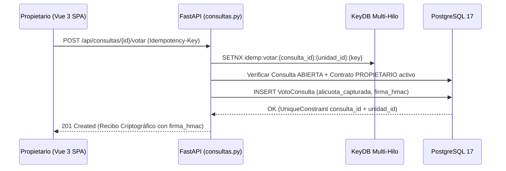

# 🗳️ Especificación 08: Dominio de Gobernanza Digital, Cartas Consulta (Art. 23 LPH) y Asambleas

**Estado:** `[ESPECIFICADO — FASE 4 / HITO 11]`  
**Módulos Backend Objetivo:** `backend/src/models.py`, `backend/src/schemas.py`, `backend/src/routers/consultas.py`, `backend/alembic/versions/0004_hito11_cartas_consulta.py`  
**Módulos Frontend Objetivo:** `frontend/src/stores/governanceStore.ts`, `frontend/src/views/governance/ConsultationsListView.vue`, `frontend/src/views/governance/ConsultationDetailView.vue`, `frontend/src/components/governance/VoteReceiptModal.vue`

---

## 1. Propósito y Fundamento Legal (Art. 22, 23 y 24 LPH)

Bajo la **Ley de Propiedad Horizontal (LPH)** de Venezuela y legislaciones homólogas en Latinoamérica, las decisiones sobre conservación, mejoras, cuotas extraordinarias o elección de la Junta de Condominio deben someterse a la voluntad de los copropietarios mediante dos mecanismos formales:
1. **Carta Consulta / Consulta Escrita (Art. 23 LPH):** Mecanismo asíncrono ideal para comunidades con propietarios a distancia. Cada propietario emite su voto por escrito dentro del plazo fijado.
   - **Ponderación por Alícuota:** El peso del voto **no** es "1 persona = 1 voto", sino el porcentaje de **alícuota** (`Unidad.alicuota`, Art. 7 LPH) de cada unidad inmobiliaria.
   - **Quórum de Primera Consulta (`DOS_TERCIOS`):** Requiere el voto favorable de propietarios que representen al menos **dos tercios ($66.67\%$)** del valor total del inmueble (`quorum_requerido_alicuota = Decimal("66.6700")`).
   - **Segunda Consulta (`MAYORIA_SIMPLE`) y Unanimidad (`UNANIMIDAD`):** Cuando la primera consulta no alcanza el quórum o cuando el Documento de Condominio exige mayorías específicas ($50.01\%$ o $100.00\%$).
2. **Asamblea de Copropietarios (Art. 24 LPH):** Convocatoria formal con orden del día, que además es obligatoria cuando la solicitan propietarios que representen al menos **un tercio ($33.33\%$)** del valor básico del inmueble.
3. **Asiento Obligatorio en el Libro de Acuerdos:** El Artículo 23 LPH exige conservar los comprobantes de las respuestas recibidas y asentar el resultado en el Libro de Acuerdos (`BitacoraActa`).

---

## 2. Modelo de Datos Relacional (SQLAlchemy 2.0 + PostgreSQL 17)

### 2.1. Extensión de `ContratoOcupacion` (`contratos_ocupacion`)
- Se añade la columna `puede_votar_asamblea: Mapped[bool] = mapped_column(Boolean, default=True, nullable=False)`:
  - Para `tipo_relacion = "PROPIETARIO"`, por defecto es `True`.
  - Para `tipo_relacion = "INQUILINO"`, por defecto es `False` (solo puede votar si el propietario o el `PRESIDENTE` registra carta poder habilitando `puede_votar_asamblea = True`).

### 2.2. Tabla `ConsultaComunitaria` (`consultas_comunitarias`)
| Columna | Tipo SQL | Restricciones | Descripción |
| :--- | :--- | :--- | :--- |
| `id` | `INTEGER` | `PRIMARY KEY` | Identificador único de la Carta Consulta o Asamblea. |
| `titulo` | `VARCHAR(160)` | `NOT NULL` | Título formal de la consulta (ej. `"Carta Consulta #04-2026: Impermeabilización Torre A"`). |
| `descripcion_legal` | `TEXT` | `NOT NULL` | Exposición de motivos, presupuesto referencial en USD y sustento en Art. 22/23 LPH. |
| `tipo_consulta` | `VARCHAR(30)` | `NOT NULL` | `"CARTA_CONSULTA_1RA" \| "CARTA_CONSULTA_2DA" \| "ASAMBLEA_ORDINARIA" \| "ASAMBLEA_EXTRAORDINARIA"` |
| `regla_quorum` | `VARCHAR(30)` | `NOT NULL` | `"DOS_TERCIOS" (66.67%) \| "MAYORIA_SIMPLE" (50.01%) \| "UNANIMIDAD" (100.00%)` |
| `quorum_minimo_alicuota` | `NUMERIC(7, 4)` | `NOT NULL DEFAULT 66.6700` | Porcentaje mínimo de alícuota requerido para aprobar o validar el acuerdo. |
| `fecha_apertura` | `TIMESTAMP WITH TIME ZONE` | `NOT NULL` | Inicio de recepción de votos. |
| `fecha_cierre` | `TIMESTAMP WITH TIME ZONE` | `NOT NULL` | Límite temporal para emitir votos. |
| `estado` | `VARCHAR(20)` | `NOT NULL DEFAULT 'ABIERTA'` | `"ABIERTA" \| "CERRADA_APROBADA" \| "CERRADA_RECHAZADA" \| "CERRADA_SIN_QUORUM"` |
| `creada_por_id` | `INTEGER` | `FOREIGN KEY (usuarios.id) NOT NULL` | Miembro de la Junta (`PRESIDENTE` o `SECRETARIO`) que abrió la consulta. |
| `acta_bitacora_id` | `INTEGER` | `FOREIGN KEY (bitacora_actas.id) NULL` | Referencia al acta inmutable generada automáticamente al cerrar la consulta. |

### 2.3. Tabla `OpcionConsulta` (`opciones_consulta`)
| Columna | Tipo SQL | Restricciones | Descripción |
| :--- | :--- | :--- | :--- |
| `id` | `INTEGER` | `PRIMARY KEY` | Identificador de la opción. |
| `consulta_id` | `INTEGER` | `FOREIGN KEY (consultas_comunitarias.id) ON DELETE CASCADE NOT NULL` | Consulta a la que pertenece. |
| `etiqueta` | `VARCHAR(120)` | `NOT NULL` | Ej. `"APROBAR PRESUPUESTO A"`, `"RECHAZAR PROPUESTA"`, `"ABSTENCIÓN"`. |
| `es_opcion_aprobatoria` | `BOOLEAN` | `NOT NULL DEFAULT FALSE` | Indica si esta opción representa un voto afirmativo para el cálculo de aprobación legal. |

### 2.4. Tabla `VotoConsulta` (`votos_consulta`) — Inmutable y Firmada
| Columna | Tipo SQL | Restricciones | Descripción |
| :--- | :--- | :--- | :--- |
| `id` | `INTEGER` | `PRIMARY KEY` | Identificador del voto. |
| `consulta_id` | `INTEGER` | `FOREIGN KEY (consultas_comunitarias.id) NOT NULL` | Consulta votada. |
| `unidad_id` | `INTEGER` | `FOREIGN KEY (unidades.id) NOT NULL` | Unidad inmobiliaria que ejerce el voto (`UniqueConstraint("consulta_id", "unidad_id")`). |
| `usuario_id` | `INTEGER` | `FOREIGN KEY (usuarios.id) NOT NULL` | Propietario (o apoderado autorizado) que emitió el voto. |
| `opcion_id` | `INTEGER` | `FOREIGN KEY (opciones_consulta.id) NOT NULL` | Opción seleccionada. |
| `alicuota_capturada` | `NUMERIC(7, 4)` | `NOT NULL` | Fotografía inmutable de `Unidad.alicuota` en el instante del voto. |
| `fecha_voto` | `TIMESTAMP WITH TIME ZONE` | `NOT NULL` | Marca de tiempo UTC exacta. |
| `ip_hash` | `VARCHAR(64)` | `NOT NULL` | Hash SHA-256 salado de la IP de origen (privacidad + auditoría forense). |
| `firma_hmac` | `VARCHAR(64)` | `UNIQUE NOT NULL` | Recibo criptográfico `HMAC-SHA256` verificable por el propietario. |

---

## 3. Reglas de Seguridad, No Repudio e Idempotencia

### 3.1. Invariante de "Una Unidad = Un Voto Ponderado por su Alícuota"
1. Cuando un usuario autenticado y activo (`es_activo = True`) invoca `POST /api/consultas/{consulta_id}/votar`, el backend verifica que exista un `ContratoOcupacion` vigente (`fecha_fin IS NULL`) entre `usuario.id` y la `unidad_id` indicada, con `tipo_relacion == "PROPIETARIO"` o `puede_votar_asamblea == True`.
2. Si un inquilino sin poder delegado intenta votar, se rechaza con `HTTP 403 Forbidden` (`"Solo el propietario titular o un representante con poder registrado puede votar en Cartas Consulta"`).
3. La restricción `UniqueConstraint("consulta_id", "unidad_id")` garantiza en motor de base de datos que, aunque una unidad tenga dos copropietarios registrados, **solo se admite un voto por unidad inmobiliaria**. Cualquier segundo intento devuelve `HTTP 409 Conflict`.

### 3.2. Recibo Criptográfico de Votación (`HMAC-SHA256`)
Cada voto genera un comprobante auditable que se entrega al vecino en la respuesta JSON (`VoteReceiptModal.vue`):
$$\text{mensaje} = \text{"VOTO|v1|"} \parallel \text{consulta\_id} \parallel \text{"|"} \parallel \text{unidad\_id} \parallel \text{"|"} \parallel \text{opcion\_id} \parallel \text{"|"} \parallel \text{alicuota\_capturada} \parallel \text{"|"} \parallel \text{fecha\_voto\_iso}$$
$$\text{firma\_hmac} = \text{HMAC-SHA256}(\text{JWT\_SECRET\_KEY}, \text{mensaje})$$

### 3.3. Cierre Idempotente y Generación Automática de Acta en `BitacoraActa`
Al ejecutar `POST /api/consultas/{consulta_id}/cerrar` (`PRESIDENTE` o `SECRETARIO`):
1. Se calcula con `Decimal` la participación total $\sum \text{alicuota\_capturada}$ y el porcentaje alcanzado por cada opción.
2. Se determina el estado final:
   - Si la participación total es menor a `quorum_minimo_alicuota` $\rightarrow$ `"CERRADA_SIN_QUORUM"`.
   - Si la opción ganadora con `es_opcion_aprobatoria = True` alcanza el umbral requerido $\rightarrow$ `"CERRADA_APROBADA"`.
   - En caso contrario $\rightarrow$ `"CERRADA_RECHAZADA"`.
3. En la **misma transacción atómica**, se inserta automáticamente un registro en `BitacoraActa` (`tipo_evento = "ASAMBLEA"`) con el resumen estadístico, el listado de unidades participantes, el porcentaje de alícuota escrutado y el hash acumulado de todos los votos, vinculando `consulta.acta_bitacora_id = acta.id`.

---

## 4. Contratos de Endpoints REST (`backend/src/routers/consultas.py`)

| Método | Ruta | Rol Requerido | Alcance `Idempotency-Key` | Descripción y Códigos de Respuesta |
| :--- | :--- | :--- | :--- | :--- |
| `POST` | `/api/consultas` | `PRESIDENTE`, `SECRETARIO` | `idemp:crear_consulta:{user_id}:{key}` | Crea una nueva Carta Consulta o convocatoria de Asamblea con sus opciones (`201 Created`, `422 Unprocessable Entity`). |
| `GET` | `/api/consultas` | Usuario Activo | N/A (`GET`) | Lista las consultas activas e históricas con el avance en tiempo real de participación por alícuota (`200 OK`). |
| `GET` | `/api/consultas/{consulta_id}` | Usuario Activo | N/A (`GET`) | Retorna el detalle de la consulta, sus opciones, el quórum acumulado en `Decimal` y si la unidad del usuario ya votó (`200 OK`, `404 Not Found`). |
| `POST` | `/api/consultas/{consulta_id}/votar` | `PROPIETARIO` (o apoderado activo) | `idemp:votar:{consulta_id}:{unidad_id}:{key}` | Registra el voto inmutable ponderado por la alícuota de la unidad y devuelve el recibo firmado (`201 Created`, `403 Forbidden`, `409 Conflict` si ya votó o consulta cerrada). |
| `POST` | `/api/consultas/{consulta_id}/cerrar` | `PRESIDENTE`, `SECRETARIO` | `idemp:cerrar_consulta:{consulta_id}:{key}` | Cierra el escrutinio, determina el resultado legal según el quórum de alícuotas y asienta el acta en `BitacoraActa` (`200 OK`, `409 Conflict` si ya estaba cerrada). |
