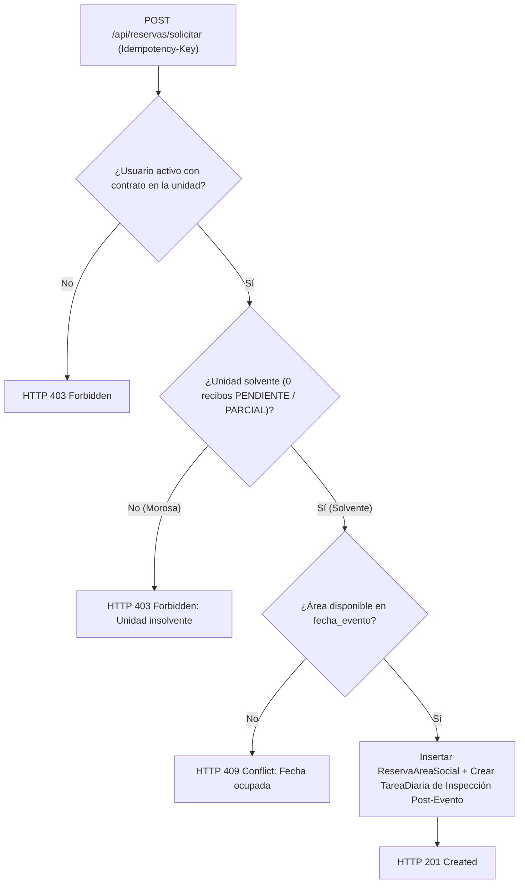

# 🛂 Especificación 09: Dominio de Control de Acceso QR, Paquetería en Garita y Reserva de Áreas Sociales

**Estado:** `[HITOS 12 Y 13 IMPLEMENTADOS Y CERTIFICADOS (ACCESOS QR + PAQUETERÍA + RESERVA DE ÁREAS SOCIALES E INSPECCIÓN POST-EVENTO)]`  
**Módulos Backend Objetivo:** `backend/src/models.py`, `backend/src/schemas.py`, `backend/src/routers/accesos.py`, `backend/src/routers/reservas.py`, `backend/alembic/versions/0005_hito12_accesos_paqueteria.py`, `backend/alembic/versions/0006_hito13_reservas_areas.py`  
**Módulos Frontend Objetivo:** `frontend/src/stores/accessAmenitiesStore.ts`, `frontend/src/views/operations/VisitorPassesView.vue`, `frontend/src/views/operations/GatehouseScannerView.vue`, `frontend/src/views/operations/ParcelsTrackerView.vue`, `frontend/src/views/operations/AmenitiesReservationView.vue`

---

## 1. Propósito Operativo y de Seguridad Física

En edificios y conjuntos residenciales modernos, la seguridad perimetral en garita/conserjería y el uso ordenado de las áreas comunes están directamente conectados con la gestión administrativa y financiera:
1. **Control de Acceso Peatonal y Vehicular (Pases QR Firmados):** Sustituye las llamadas telefónicas informales a garita por autorizaciones digitales verificables con firma `HMAC-SHA256` y protección contra ataques de repetición (*Anti-Replay Nonce* en **KeyDB Multi-Hilo**).
2. **Trazabilidad de Paquetería y Encomiendas:** Registra la cadena de custodia desde que el conserje recibe un paquete en garita hasta que el residente confirma su retiro.
3. **Reserva de Áreas Sociales Vinculada a Solvencia:** Garantiza que el disfrute de áreas no esenciales de recreación (Salón de Fiestas, Parrillera, Caney, Cancha) sea exclusivo para unidades **solventes** ($\text{deuda} == \$0.00\text{ USD}$), exigiendo además inspección fotográfica del conserje tras el evento.

---

## 2. Modelo de Datos Relacional (SQLAlchemy 2.0 + PostgreSQL 17)

### 2.1. Tabla `PaseVisita` (`pases_visita`)
| Columna | Tipo SQL | Restricciones | Descripción |
| :--- | :--- | :--- | :--- |
| `id` | `INTEGER` | `PRIMARY KEY` | Identificador interno del pase. |
| `jti` | `VARCHAR(36)` | `UNIQUE NOT NULL` | UUIDv4 único del token QR (*Nonce ID* para control anti-replay en KeyDB). |
| `unidad_id` | `INTEGER` | `FOREIGN KEY (unidades.id) NOT NULL` | Unidad anfitriona que autoriza el ingreso. |
| `creado_por_id` | `INTEGER` | `FOREIGN KEY (usuarios.id) NOT NULL` | Residente activo que emitió la invitación. |
| `nombre_visitante` | `VARCHAR(120)` | `NOT NULL` | Nombre y apellido del visitante o técnico. |
| `cedula_visitante` | `VARCHAR(25)` | `NOT NULL` | Documento de identidad a verificar en garita. |
| `placa_vehiculo` | `VARCHAR(20)` | `NULL` | Placa vehicular opcional si ingresa al estacionamiento de visitantes. |
| `modalidad` | `VARCHAR(20)` | `NOT NULL DEFAULT 'UNICO_USO'` | `"UNICO_USO" \| "VENTANA_TEMPORAL"` |
| `valido_desde` | `TIMESTAMP WITH TIME ZONE` | `NOT NULL` | Inicio de la ventana de validez. |
| `valido_hasta` | `TIMESTAMP WITH TIME ZONE` | `NOT NULL` | Fin de la ventana de validez (máximo 72 horas por pase). |
| `estado` | `VARCHAR(20)` | `NOT NULL DEFAULT 'ACTIVO'` | `"ACTIVO" \| "USADO" \| "REVOCADO" \| "EXPIRADO"` |
| `usado_en` | `TIMESTAMP WITH TIME ZONE` | `NULL` | Marca de tiempo exacta del ingreso registrado en garita. |
| `verificado_por_id` | `INTEGER` | `FOREIGN KEY (usuarios.id) NULL` | Conserje o vigilante que escaneó el pase. |
| `firma_hmac` | `VARCHAR(64)` | `NOT NULL` | Firma `HMAC-SHA256` del payload del pase. |

### 2.2. Tabla `PaqueteRecibido` (`paquetes_recibidos`)
| Columna | Tipo SQL | Restricciones | Descripción |
| :--- | :--- | :--- | :--- |
| `id` | `INTEGER` | `PRIMARY KEY` | Identificador del paquete. |
| `unidad_id` | `INTEGER` | `FOREIGN KEY (unidades.id) NOT NULL` | Unidad destinataria. |
| `recibido_por_id` | `INTEGER` | `FOREIGN KEY (usuarios.id) NOT NULL` | Conserje que recepcionó el paquete en garita. |
| `empresa_envio` | `VARCHAR(60)` | `NOT NULL` | Ej. `"ZOOM"`, `"MRW"`, `"TEALCA"`, `"PEDIDOSYA"`, `"MERCADOLIBRE"`, `"OTRO"`. |
| `descripcion` | `VARCHAR(200)` | `NOT NULL` | Descripción breve del sobre o caja. |
| `url_foto_evidencia` | `VARCHAR(500)` | `NULL` | URL validada con `UrlEvidenciaSegura` de la foto del paquete al llegar. |
| `estado` | `VARCHAR(20)` | `NOT NULL DEFAULT 'EN_GARITA'` | `"EN_GARITA" \| "ENTREGADO"` |
| `fecha_recepcion` | `TIMESTAMP WITH TIME ZONE` | `NOT NULL` | Fecha y hora de ingreso a conserjería. |
| `fecha_entrega` | `TIMESTAMP WITH TIME ZONE` | `NULL` | Fecha y hora de retiro por el residente. |
| `retirado_por_id` | `INTEGER` | `FOREIGN KEY (usuarios.id) NULL` | Residente que retiró o confirmó la recepción. |

### 2.3. Tablas `AreaSocial` (`areas_sociales`) y `ReservaAreaSocial` (`reservas_areas_sociales`)

#### A. `AreaSocial` (`areas_sociales`)
- `id`: `INTEGER PRIMARY KEY`
- `nombre`: `VARCHAR(100) UNIQUE NOT NULL` (ej. `"Salón de Fiestas Principal"`, `"Parrillera Este"`)
- `aforo_maximo`: `INTEGER NOT NULL` (`CHECK (aforo_maximo > 0)`)
- `costo_uso_usd`: `NUMERIC(10, 2) NOT NULL DEFAULT 0.00`
- `deposito_garantia_usd`: `NUMERIC(10, 2) NOT NULL DEFAULT 0.00`
- `requiere_solvencia_estricta`: `BOOLEAN NOT NULL DEFAULT TRUE`
- `es_activa`: `BOOLEAN NOT NULL DEFAULT TRUE`

#### B. `ReservaAreaSocial` (`reservas_areas_sociales`)
- `id`: `INTEGER PRIMARY KEY`
- `area_id`: `INTEGER FOREIGN KEY (areas_sociales.id) NOT NULL`
- `unidad_id`: `INTEGER FOREIGN KEY (unidades.id) NOT NULL`
- `solicitante_id`: `INTEGER FOREIGN KEY (usuarios.id) NOT NULL`
- `fecha_evento`: `DATE NOT NULL` (`UniqueConstraint("area_id", "fecha_evento")` para reservas exclusivas por día)
- `motivo_evento`: `VARCHAR(160) NOT NULL`
- `estado`: `VARCHAR(30) NOT NULL DEFAULT 'PENDIENTE_REVISION'` (`"PENDIENTE_REVISION" | "CONFIRMADA" | "RECHAZADA" | "FINALIZADA_SIN_DANOS" | "FINALIZADA_CON_DANOS" | "CANCELADA"`)
- `tarea_inspeccion_id`: `INTEGER FOREIGN KEY (tareas_diarias.id) NULL` (vínculo automático con el checklist del conserje para recibir el área limpia tras el evento)
- `observaciones_inspeccion`: `TEXT NULL`

---

## 3. Arquitectura Criptográfica de Pases QR y Anti-Replay en KeyDB

### 3.1. Construcción del Token QR Compacto
1. Nunca se incluye información personal sensible en texto plano dentro del código QR si se comparte externamente; se firma un payload estructurado:
   $$\text{claims} = \text{"QR|v1|"} \parallel \text{jti} \parallel \text{"|"} \parallel \text{unidad\_id} \parallel \text{"|"} \parallel \text{modalidad} \parallel \text{"|"} \parallel \text{exp\_unix}$$
   $$\text{sig} = \text{HMAC-SHA256}(\text{JWT\_SECRET\_KEY}, \text{claims})$$
   $$\text{qr\_token} = \text{base64url}(\text{claims}) \parallel \text{"."} \parallel \text{sig}$$
2. **Validación en Garita (`POST /api/accesos/verificar-qr`):**
   - **Paso 1:** Verifica la firma `HMAC-SHA256` en tiempo constante (`hmac.compare_digest`). Si falla $\rightarrow$ `HTTP 400 Bad Request` (`"Firma criptográfica de pase QR inválida"`).
   - **Paso 2:** Verifica que `valido_desde <= ahora_utc <= valido_hasta`. Si está fuera de rango $\rightarrow$ `HTTP 409 Conflict` (`"Pase QR expirado o aún no vigente"`).
   - **Paso 3 (Anti-Replay en KeyDB Multi-Hilo):** Si `modalidad == "UNICO_USO"`, intenta registrar `SET qr_used:{jti} 1 NX EX {ttl_segundos}` en KeyDB y actualiza `PaseVisita.estado = "USADO"`. Si la clave ya existía en KeyDB o en PostgreSQL $\rightarrow$ `HTTP 409 Conflict` (`"Alerta de Seguridad: Este pase QR de único uso ya fue utilizado"`).

---

## 4. Regla de Solvencia Estricta en Reserva de Áreas Sociales

1. **Bloqueo Automático por Morosidad:**
   - Antes de insertar una `ReservaAreaSocial`, el backend consulta `Recibo` para la `unidad_id` solicitante.
   - Si existe al menos un recibo con `estado IN ("PENDIENTE", "PARCIAL")` ($\text{monto\_total} > \text{monto\_pagado}$), se rechaza inmediatamente con `HTTP 403 Forbidden` sin permitir excepciones manuales por API.
2. **Integración Automática con Conserjería (`TareaDiaria`):**
   - Al confirmarse una reserva (`PUT /api/reservas/{id}/aprobar` o creación directa si `costo_uso_usd == 0`), el sistema crea automáticamente una `TareaDiaria` para el `CONSERJE` en la fecha del evento: `"Inspeccionar entrega de {area.nombre} tras reserva de Unidad {unidad.identificador}"`, vinculándola en `ReservaAreaSocial.tarea_inspeccion_id`.

---

## 5. Contratos de Endpoints REST e Idempotencia

| Método | Ruta | Rol Requerido | Alcance `Idempotency-Key` | Descripción y Códigos de Respuesta |
| :--- | :--- | :--- | :--- | :--- |
| `POST` | `/api/accesos/pases` | Usuario Activo (con unidad asignada) | `idemp:crear_pase:{user_id}:{key}` | Emite un `PaseVisita` con su `qr_token` firmado con `HMAC-SHA256` (`201 Created`, `422 Unprocessable Entity`). |
| `GET` | `/api/accesos/pases/mios` | Usuario Activo | N/A (`GET`) | Lista los pases de visita activos e históricos de la unidad del residente (`200 OK`). |
| `DELETE` | `/api/accesos/pases/{pase_id}` | Creador del pase o `PRESIDENTE` | N/A (`DELETE` idempotente) | Revoca inmediatamente un pase activo (`estado = "REVOCADO"`) y quema su `jti` en KeyDB (`200 OK`, `404 Not Found`). |
| `POST` | `/api/accesos/verificar-qr` | `CONSERJE`, `PRESIDENTE`, `VOCERO` | `idemp:scan_qr:{user_id}:{key}` | Valida la firma, vigencia y unicidad del `qr_token` en garita (`200 OK` con datos del visitante y unidad destino, `400 Bad Request`, `409 Conflict`). |
| `POST` | `/api/paqueteria/registrar` | `CONSERJE`, `PRESIDENTE` | `idemp:paquete:{user_id}:{key}` | Registra la recepción de una encomienda en garita y encola notificación a la unidad (`201 Created`). |
| `GET` | `/api/paqueteria` | Usuario Activo (ve los de su unidad; Conserje/Junta ven todos) | N/A (`GET`) | Lista paquetes pendientes en garita e historial de entregas (`200 OK`). |
| `PUT` | `/api/paqueteria/{paquete_id}/entregar` | `CONSERJE` o Residente destinatario | N/A (`PUT` idempotente) | Marca el paquete como `"ENTREGADO"` con timestamp y usuario receptor (`200 OK`, `409 Conflict` si ya fue entregado). |
| `POST` | `/api/reservas/areas` | `PRESIDENTE`, `TESORERO` | `idemp:crear_area:{user_id}:{key}` | Da de alta un `AreaSocial` reservable (`201 Created`, `409 Conflict`). |
| `GET` | `/api/reservas/areas` | Usuario Activo | N/A (`GET`) | Lista las áreas sociales y su calendario de disponibilidad (`200 OK`). |
| `GET` | `/api/reservas` | Usuario Activo | N/A (`GET`) | Lista reservas confirmadas e inspeccionadas (todas para Junta/Conserje; propias para residentes) (`200 OK`). |
| `POST` | `/api/reservas/solicitar` | Usuario Activo (**Unidad Solvente**) | `idemp:reservar:{unidad_id}:{key}` | Valida solvencia estricta ($0.00\text{ USD}$ deuda), bloquea la fecha del área social y crea la tarea de inspección del conserje (`201 Created`, `403 Forbidden` si insolvente, `409 Conflict` si fecha ocupada). |
| `PUT` | `/api/reservas/{reserva_id}/inspeccionar` | `CONSERJE`, `PRESIDENTE`, `TESORERO` | N/A (`PUT` idempotente) | Registra el resultado de la inspección post-evento (`"FINALIZADA_SIN_DANOS"` o `"FINALIZADA_CON_DANOS"`) y completa la `TareaDiaria` asociada (`200 OK`). |
