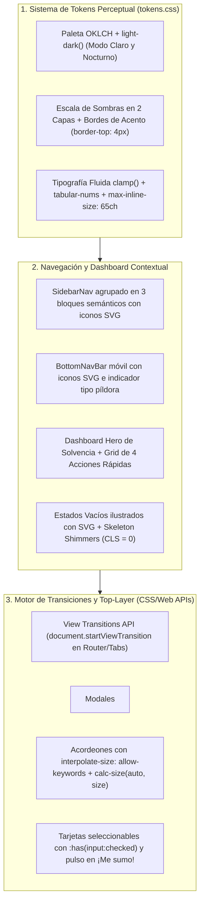

# ✨ Especificación 10: Diseño UX/UI Amigable ("Hospitalidad Residencial"), Sistema de Tokens OKLCH, Modo Oscuro y Micro-Transiciones Modernas

**Estado:** Especificación Formal Lista para Implementación (Hito 15)  
**Ecosistema:** Vue 3 (`<script setup lang="ts">`) + CSS Moderno (`OKLCH`, `light-dark()`, `@starting-style`, `transition-behavior: allow-discrete`, `overlay`, `View Transitions API`, `interpolate-size`, `calc-size()`, `:has()`, `container-type: inline-size`)  
**Fuentes de Diseño y Plataforma:** Investigación PropTech 2025–2026 + `refactoring-ui` + `modern-web-guidance`

---

## 1. Visión de Diseño: De "Portal Contable Frío" a "Hospitalidad Residencial Cálida"

Una aplicación de condominio no es un terminal financiero corporativo: para el vecino representa **la tranquilidad de su hogar** y la convivencia con su comunidad. Esta especificación define las mejoras visuales, ergonómicas y de movimiento para que **Condominio App** sea cálida, intuitiva, 100% responsiva y accesible para todas las generaciones:

1. **Hospitalidad Residencial y Refuerzo Positivo:**
   - Cuando una unidad está solvente, el panel principal recibe al vecino con una tarjeta *Hero* cálida en tonos esmeralda-cielo (`oklab` gradient), icono de escudo de solvencia y acceso en 1 toque a su Certificado Digital de Solvencia QR.
   - El lenguaje de la interfaz (*microcopy*) prioriza un tono humano, claro y tranquilizador (*"¡Tu apartamento está al día!"*, *"¡Todo en orden en tu edificio!"*).
2. **Ergonomía Multi-Generacional y Zona del Pulgar (*Thumb-Zone*):**
   - Conviven jóvenes inquilinos, adultos mayores propietarios, miembros de la Junta y personal de conserjería/garita operando con una sola mano.
   - Las 4 acciones más frecuentes del residente se ubican en una cuadrícula táctil de acceso rápido y en la barra inferior móvil con iconos SVG claros (`>= 44x44px` en `@media (pointer: coarse)`).
3. **Cero Cortes Bruscos — Movimiento con Propósito Espacial:**
   - Las transiciones entre vistas, apertura/cierre de diálogos `<dialog>`, cambios de pestaña, pasos del Wizard de Pagos y paneles desplegables se animan en el **hilo del compositor** (`opacity` y `transform`), respetando siempre `@media (prefers-reduced-motion: reduce)`.



---

## 2. Sistema Centralizado de Tokens en Espacio Perceptual (`frontend/src/assets/tokens.css`)

Siguiendo las directrices de **`refactoring-ui`** (`SKILL.md`, `color.md`, `depth.md`, `polish.md`, `dark-mode.md`) y **`modern-web-guidance`** (`color`, `dark-mode`), ningún componente debe inventar valores arbitrarios fuera de la escala del sistema.

### 2.1. Paleta en `OKLCH` con Temperatura y Soporte `light-dark()`
- Se declara `color-scheme: light dark;` en `:root` (con soporte de selector manual `.theme-light` / `.theme-dark` en `<html>` para conserjes en turno nocturno o preferencia del vecino).
- Los grises llevan una sutil saturación azul-pizarra en superficies frías y cálida en tarjetas de bienvenida, evitando el negro puro (`#000000`) que produce deslumbramiento.
- Para generar tintes dinámicos seguros dentro del gamut del monitor (`color` guide), se utiliza `color-mix(in oklab, ...)` en lugar de manipular aisladamente el canal `L` por encima del 30%:

```css
:root {
  color-scheme: light dark;
  interpolate-size: allow-keywords;

  /* Superficies y Texto (Roles Semánticos light-dark) */
  --surface-canvas: light-dark(#f8fafc, #0b1120);
  --surface-card: light-dark(#ffffff, #111827);
  --surface-elevated: light-dark(#ffffff, #1e293b);
  --surface-subtle: light-dark(#f1f5f9, #1e293b);

  --text-primary: light-dark(#0f172a, #f8fafc);
  --text-secondary: light-dark(#475569, #cbd5e1);
  --text-tertiary: light-dark(#64748b, #94a3b8);

  /* Marca Residencial (Cielo-Esmeralda Hospitalario) */
  --brand-500: oklch(0.58 0.15 235);
  --brand-600: oklch(0.51 0.15 235);
  --brand-700: oklch(0.44 0.14 235);
  --brand-tint: light-dark(
    color-mix(in oklab, var(--brand-500), white 88%),
    color-mix(in oklab, var(--brand-500), black 72%)
  );

  /* Estados Semánticos (Solvencia / Alerta / Morosidad) */
  --status-ok-bg: light-dark(#ecfdf5, #064e3b);
  --status-ok-text: light-dark(#065f46, #a7f3d0);
  --status-ok-accent: #10b981;

  --status-warn-bg: light-dark(#fffbeb, #451a03);
  --status-warn-text: light-dark(#92400e, #fde68a);
  --status-warn-accent: #f59e0b;

  --status-danger-bg: light-dark(#fef2f2, #450a0a);
  --status-danger-text: light-dark(#991b1b, #fecaca);
  --status-danger-accent: #ef4444;

  /* Radios Concéntricos */
  --radius-sm: 0.5rem;
  --radius-md: 0.75rem;
  --radius-lg: 1rem;
  --radius-pill: 9999px;

  /* Sombras en Dos Partes (refactoring-ui depth.md) y Contorno en Modo Oscuro */
  --shadow-card:
    0 1px 3px 0 rgb(15 23 42 / 0.06),
    0 1px 2px -1px rgb(15 23 42 / 0.05);
  --shadow-elevated:
    0 10px 20px -5px rgb(15 23 42 / 0.1),
    0 4px 6px -4px rgb(15 23 42 / 0.06);
  --shadow-modal: 0 25px 50px -12px rgb(15 23 42 / 0.28);
  --card-ring: light-dark(rgb(15 23 42 / 0.08), rgb(255 255 255 / 0.1));
}
```

### 2.2. Reglas de Contraste No Textual y `Forced Colors Mode` (`color` guide)
- **Prohibido usar únicamente el color para indicar estado:** En `CollectionTrafficLight.vue`, `SolvencyCertificateView.vue`, `ConsultationsListView.vue` y alertas `.banner`, cada insignia de estado incluye siempre un **icono o glifo semántico** (`✓ Solvente`, `◐ Abono Parcial`, `! Pendiente`, `⏳ En Revisión`) además del color.
- **Contraste mínimo `3:1` en bordes de controles de formulario:** Los inputs, selectores y casillas mantienen un borde con relación de contraste $\ge 3:1$ o se refuerzan automáticamente bajo `@media (prefers-contrast: more)`.
- **Soporte para `@media (forced-colors: active)`:** Las tarjetas que reemplazan bordes por `box-shadow` declaran un `outline: 1px solid transparent` que en modo de alto contraste del sistema garantiza visibilidad estructural sin depender de sombras.

---

## 3. Rediseño Ergonómico de Navegación y Pantallas Clave

### 3.1. Navegación Lateral Agrupada y Filtrada por Rol (`SidebarNav.vue`)
Aplicando la regla *"De-emphasize to emphasize"* de `hierarchy.md`:
1. **Agrupación en 3 Secciones con Encabezados Discretos (`0.7rem`, `uppercase`, `letter-spacing: 0.05em`):**
   - **Mi Hogar y Finanzas:** *Resumen Financiero* (`/dashboard`), *Reportar Pago* (`/finanzas/reportar-pago`), *Certificado de Solvencia* (`/finanzas/solvencia`).
   - **Comunidad y Gobernanza:** *Cartas Consulta (Art. 23)* (`/consultas`), *Embudo de Incidencias* (`/incidencias`), *Galería de Voceros* (`/voceros/galeria`), *Bitácora de Actas* (`/secretaria/bitacora`), *Pases de Visita QR* (`/accesos/pases`), *Reserva de Áreas* (`/reservas/areas`).
   - **Operaciones y Junta Directiva** *(mostrado contextualmente según el rol activo o colapsable para consulta)*: *Aprobar Pagos* (`/tesoreria/pagos`), *Facturación Mensual LPH* (`/tesoreria/facturacion`), *Cierre Mensual* (`/tesoreria/cierre`), *Tareas de Conserjería* (`/operaciones/tareas`), *Garita QR y Paquetería* (`/operaciones/garita-qr`, `/operaciones/paqueteria`), *Estructura Física* (`/admin/estructura`), *Usuarios Fantasma* (`/admin/usuarios`), *Junta de Condominio* (`/admin/junta`).
2. **Iconos SVG de Trazo Fino (`stroke-width: 1.75`):** Cada ítem del menú lleva un icono SVG con `color: var(--text-tertiary)` en reposo y `color: #38bdf8` + borde izquierdo de acento (`border-inline-start: 3px solid #38bdf8`) cuando está activo.
3. **Conmutador de Tema Claro / Oscuro (`#btn-theme-toggle`):** Ubicado en la cabecera de `SidebarNav.vue` y `AppShellLayout.vue` para alternar entre tema claro, oscuro o automático del sistema.

### 3.2. Barra Inferior Móvil con Iconos y Píldora Activa (`BottomNavBar.vue`)
- Cada botón en `BottomNavBar.vue` incorpora un icono SVG de `20x20px` sobre su etiqueta (`Inicio`, `Pagar`, `Consultas`, `Incidencias`) y una píldora de fondo animada (`transition: background-color 0.2s ease, transform 0.18s ease`) con área táctil garantizada $\ge 44\times44\text{px}$ en `@media (pointer: coarse)`.

### 3.3. Dashboard Contextual ("Tu Hogar Hoy" — `DashboardView.vue`)
1. **Tarjeta Hero con Borde de Acento (`border-block-start: 4px solid`):**
   - Si `deudaTotalUsd <= 0`, presenta borde superior esmeralda (`var(--status-ok-accent)`), insignia `✓ Al día` y acceso rápido a `/finanzas/solvencia`.
   - Si `deudaTotalUsd > 0`, presenta borde superior ámbar (`var(--status-warn-accent)`), conversión automática a Bolívares (tasa BCV en `tabular-nums`) y botón directo para reportar pago.
2. **Cuadrícula de 4 Acciones Rápidas (*Quick Actions Grid* — `#dashboard-quick-actions`):**
   - Tarjetas táctiles responsivas (`grid-template-columns: repeat(auto-fit, minmax(9rem, 1fr))`) con icono, título corto y micro-elevación al pasar el cursor o tocar:
     - `#qa-reportar-pago` $\rightarrow$ `/finanzas/reportar-pago`
     - `#qa-solvencia` $\rightarrow$ `/finanzas/solvencia`
     - `#qa-consultas` $\rightarrow$ `/consultas`
     - `#qa-incidencias` $\rightarrow$ `/incidencias`

### 3.4. Estados Vacíos Ilustrados (`EmptyStateCard.vue`) y Esqueletos de Carga (`SkeletonCard.vue`)
- **`EmptyStateCard.vue` (`polish.md` — *"Empty states come first"*):** Componente reutilizable con ilustración SVG minimalista, título amigable, descripción breve (`max-inline-size: 50ch`) y botón de acción primaria opcional. Se integra cuando una lista no tiene registros en `IncidentsFeedView.vue`, `ConsultationsListView.vue`, `TreasuryPaymentsView.vue`, `OperationsTasksView.vue` y `AdminGhostUsersView.vue`.
- **`SkeletonCard.vue` (`CLS = 0`):** Reemplaza los textos planos `"Cargando..."` por tarjetas esqueleto con dimensiones equivalentes al contenido real y animación suave que se detiene automáticamente bajo `@media (prefers-reduced-motion: reduce)`.

### 3.5. Tarjetas Seleccionables con `:has(input:checked)` (`polish.md`)
- En las opciones de votación de `ConsultationDetailView.vue` y en los selectores del Wizard de Pagos (`PaymentWizardView.vue`), las etiquetas `<label class="selectable-card">` utilizan `:has(input:checked)` para aplicar fondo tintado (`var(--brand-tint)`), anillo de `2px` (`var(--brand-500)`) y sombra de elevación sin necesidad de clases imperativas adicionales.

---

## 4. Especificación de Transiciones y Animaciones Modernas (`modern-web-guidance`)

### 4.1. Transiciones de Vista SPA con `View Transitions API` (`same-document-transitions`)
- **Enrutador (`frontend/src/router/index.ts`) y Cambios de Pestaña (`DashboardView.vue`):**
  - Se implementa un helper `runWithViewTransition(callback)` que verifica soporte para `document.startViewTransition` y respeta `window.matchMedia('(prefers-reduced-motion: reduce)')`:
    ```typescript
    export function runWithViewTransition(updateDom: () => void | Promise<void>): void {
      const prefersReducedMotion =
        typeof window !== 'undefined' &&
        typeof window.matchMedia === 'function' &&
        window.matchMedia('(prefers-reduced-motion: reduce)').matches;

      if (
        !prefersReducedMotion &&
        typeof document !== 'undefined' &&
        'startViewTransition' in document &&
        typeof document.startViewTransition === 'function'
      ) {
        document.startViewTransition(updateDom);
        return;
      }
      void updateDom();
    }
    ```
- **Regla de Unicidad de `view-transition-name` (`same-document-transitions`):**
  - Al pulsar una tarjeta de consulta en `ConsultationsListView.vue`, se asigna dinámicamente `view-transition-name: active-consultation-card` únicamente a la tarjeta seleccionada y al encabezado de `ConsultationDetailView.vue` (garantizando que nunca existan 2 elementos simultáneos con el mismo `view-transition-name`).

### 4.2. Animación de Entrada/Salida en el Top Layer para `<dialog>` y Bottom Sheet Móvil (`animate-to-from-top-layer`)
Todos los modales `<dialog>` del sistema (`RejectPaymentModal.vue`, `ReceiptBreakdownModal.vue`, `VoteReceiptModal.vue`, `ContextualHelpModal.vue`) aplican el estándar de Top Layer:
1. **Propiedades Discretas Obligatorias:**
   - `transition-property: opacity, transform, display, overlay;`
   - `transition-behavior: allow-discrete;` (declarado siempre después de las propiedades de transición).
2. **Estado Inicial de Entrada con `@starting-style`:**
   - Ubicado dentro de `:is(dialog[open]):where(:not([data-closing]))`, animando desde `opacity: 0; transform: translateY(1rem) scale(0.96);` hacia `opacity: 1; transform: translateY(0) scale(1);`.
3. **Ergonomía Bottom Sheet en Pantallas Móviles (`< 640px`):**
   - En viewports móviles, el `<dialog>` se posiciona en la parte inferior (`margin: auto 0 0 0; inline-size: 100%; max-inline-size: 100%; border-radius: 1.25rem 1.25rem 0 0;`) deslizándose desde `translateY(1.5rem)` para facilitar la operación con una sola mano.
4. **Fallback de Salida Top-Layer (`closeTopLayerDialog`) para Firefox y Safari (`animate-to-from-top-layer`):**
   - Dado que Firefox 129+ parsea `transition-behavior: allow-discrete` sin transicionar `display` (Firefox bug 1882408) y no soporta `overlay`, se provee el composable/utilidad `useTopLayerDialog.ts` que detecta soporte real con un nodo de prueba (`canTransitionDisplay()`), aplica el atributo `data-closing` al cerrar, espera `Promise.allSettled(dialog.getAnimations({ subtree: true }).map(a => a.finished))` con timeout de seguridad y luego invoca `dialog.close()`.

### 4.3. Animación hacia Tamaños Intrínsecos (`animate-to-intrinsic-sizes`)
- Para paneles colapsables como el formulario de nueva Carta Consulta en `ConsultationsListView.vue` o secciones desplegables de ayuda:
  ```css
  .collapsible-panel {
    overflow: clip;
    block-size: auto; /* Fallback para navegadores sin calc-size() */
    block-size: calc-size(auto, size);
    transition:
      block-size 0.25s cubic-bezier(0.22, 1, 0.36, 1),
      opacity 0.2s ease;
  }
  ```

### 4.4. Micro-Interacciones en el Hilo del Compositor y Accesibilidad (`motion`)
1. **Elevación Táctil de Botones (`depth.md`):**
   - Los botones primarios y tarjetas interactivas aplican `transition: transform 0.15s ease, box-shadow 0.15s ease, background-color 0.15s ease;`, bajando un paso su sombra al presionarse (`:active { transform: translateY(1px) scale(0.99); }`).
2. **Pulso de Prioridad en *"¡Me sumo!"* (`IncidentCard.vue`):**
   - Al incrementarse las adhesiones vecinales, la insignia `.incident-card__support-badge` ejecuta un breve pulso en `transform: scale(1.08)` durante `180ms`.
3. **Transición entre Pasos del Wizard (`PaymentWizardView.vue`):**
   - Los pasos 1, 2 y 3 incluyen un indicador visual de progreso conectado (`1. Recibo` $\rightarrow$ `2. Método` $\rightarrow$ `3. Comprobante`) y transicionan suavemente con `<Transition name="fade-slide" mode="out-in">`.
4. **Respeto Estricto a `@media (prefers-reduced-motion: reduce)` (`motion`):**
   - **Prohibido** usar resets globales destructivos como `* { animation-duration: 0.01ms !important }`.
   - Cada animación o transición atenúa el movimiento caso por caso (eliminando `transform` y dejando únicamente un desvanecimiento suave de `opacity` en `0.1s` o estado estático).

---

## 5. Contratos de Componentes y Pruebas Nivel 11X (Hito 15)

| Archivo / Componente | Responsabilidad | Suite Unitaria Obligatoria (`qa-orphans`) |
| :--- | :--- | :--- |
| `frontend/src/assets/tokens.css` | Variables `OKLCH`, `light-dark()`, sombras en 2 capas, radios concéntricos, utilidades de transición Top-Layer y View Transitions. | Validado en build Vite y suites de layout |
| `frontend/src/composables/useThemeMode.ts` | Gestión reactiva de tema (`light`, `dark`, `system`), persistencia segura en `localStorage` y sincronización de clase en `<html>`. | `frontend/src/composables/useThemeMode.unit.ts` |
| `frontend/src/composables/useViewTransition.ts` | Wrapper seguro `runWithViewTransition` y helper `closeTopLayerDialog` (`canTransitionDisplay` + `data-closing`). | `frontend/src/composables/useViewTransition.unit.ts` |
| `frontend/src/components/common/EmptyStateCard.vue` | Tarjeta ilustrada con SVG amigable, título, mensaje y CTA opcional para listas vacías. | `frontend/src/components/common/EmptyStateCard.unit.ts` |
| `frontend/src/components/common/SkeletonCard.vue` | Esqueleto de carga accesible (`aria-busy="true"`) sin desplazamiento de layout (`CLS = 0`). | `frontend/src/components/common/SkeletonCard.unit.ts` |
| `SidebarNav.vue` y `BottomNavBar.vue` | Iconos SVG de trazo fino, agrupación en 3 secciones semánticas filtradas por rol, píldora activa y botón `#btn-theme-toggle`. | `SidebarNav.unit.ts`, `BottomNavBar.unit.ts` |
| `DashboardView.vue` y `CollectionTrafficLight.vue` | Tarjeta Hero de solvencia con borde de acento, cuadrícula `#dashboard-quick-actions`, iconos de estado para daltónicos y cambio de pestañas con View Transition. | `DashboardView.unit.ts`, `CollectionTrafficLight.unit.ts` |
| Modales `<dialog>` (`RejectPaymentModal.vue`, `ReceiptBreakdownModal.vue`, `VoteReceiptModal.vue`) | Animación `@starting-style` + `allow-discrete` + `overlay`, diseño Bottom Sheet en móvil y cierre suave con `closeTopLayerDialog`. | Suites `.unit.ts` respectivas |
